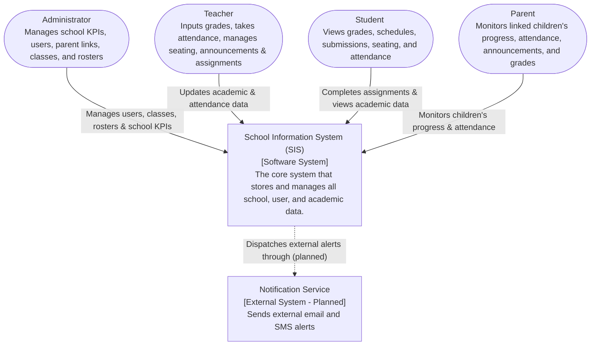
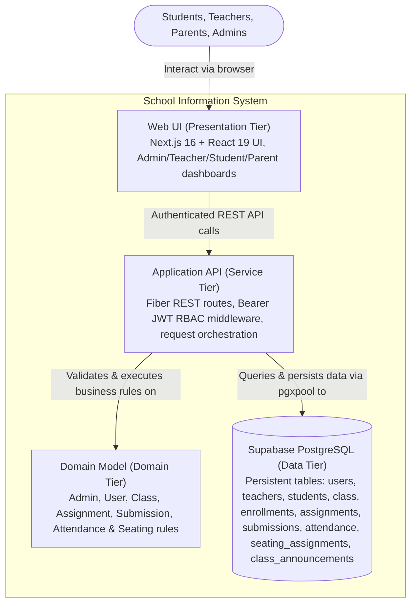
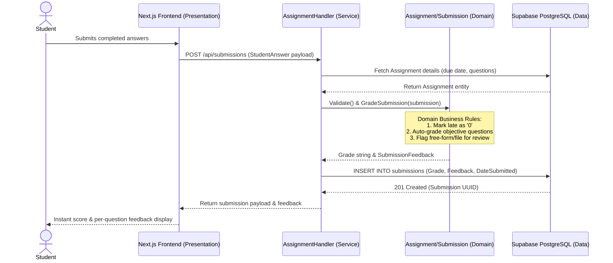

# [School Information System]

<!-- CI badge: after Session 4, replace ORG/REPO and the workflow filename, then uncomment:

-->

**Student:** Joseph Gabrie · **Course:** CEN 5064 Software Design, Fall 2026 · **Partner:** @Jesse-Trueba

## Project (approval paragraph — write this by Sun Aug 30)

My project is a School Information System (SIS) built for a K-8 school.
The core features of the system are:
1. **Admin Dashboard & School Management System** (school-wide KPI metrics, class section scheduling, student roster enrollment, user directory provisioning, and parent-student account linking)
2. **Attendance & Interactive Seating System** (daily present/absent/tardy tracking, historical attendance logs, and an interactive 4×5 classroom seating chart)
3. **Assignment, Quiz & Instant Auto-Grading System** (custom multi-question quizzes and file assignments, automatic grading with late-submission enforcement, per-question feedback, and manual teacher grade overrides)
4. **Class Announcement & Parent Portal System** (class-level announcements, unified academic calendar, and a dedicated Parent Portal aggregating linked children's classes, grades, attendance summaries, and announcements)

My tech stack uses **Next.js (React + TypeScript)** for the Frontend, **Golang (Fiber)** for the Backend, and **Supabase (PostgreSQL)** for the Database.

---

## Project Scope

### Written Scope Statement
The **K-8 School Information System (SIS)** is a full-stack, role-based web application designed to centralize daily academic and administrative operations for elementary and middle schools. The platform serves four distinct authenticated roles—**Students**, **Teachers**, **Parents**, and **Administrators**—through a strict 4-tier architecture (Presentation, Service, Domain, and Data).

#### In-Scope (Implemented & Connected Features)
1. **Authentication & Role-Based Access Control (RBAC)**:
   - Credential login (`POST /api/login/`) supporting numeric school User IDs or email addresses verified against `bcrypt` password hashes.
   - Signed HS256 JWT issuance and verification (`Authorization: Bearer <token>`), enforcing server-side role checks (`AdminRoleMiddleware`, `RequiredLogin`, `RequiredRoles`) so clients cannot spoof roles via custom headers.
2. **Admin Dashboard & School-Wide Management (`/api/admin/*`)**:
   - **School-Wide KPI Overview**: Real-time calculation of total students, teachers, parents, admins, active classes, student-to-teacher ratio, and daily attendance rate with health classifications (`Healthy`, `Warning`, `Critical`, `No Data`).
   - **Class Section & Roster Management**: Creating class sections (`POST /api/admin/classes`), assigning teachers, and enrolling students (`POST /api/admin/classes/:classId/enroll`) with domain validation preventing duplicate enrollments.
   - **User Directory & Account Provisioning**: Searchable and role-filterable user directory (`GET /api/admin/users`), account creation (`POST /api/admin/users`) with cryptographically generated role-based IDs (`6-digit` for students, `8-digit` for staff/parents) and `bcrypt` password hashing, and parent-to-student linkage (`POST /api/admin/parent-links`).
3. **Assignment, Quiz & Auto-Grading Engine (`/api/assignments/*`, `/api/submissions/*`)**:
   - Teachers can create, edit, and manage due dates for both interactive multi-question quizzes and document-based assignments.
   - Pure domain auto-grading (`GradeAssignment` & `EvaluateSubmissionFeedback`) that scores objective questions, enforces a `0` score on late submissions (`IsLate`), flags free-form or file submissions as `"Needs Manual Grading"`, and allows teachers to override or finalize grades (`PUT /api/submissions/:id/grade`).
4. **Classroom Attendance & Interactive Seating Grid (`/api/classes/:classId/attendance`, `/api/classes/:classId/seating`)**:
   - Interactive 4×5 classroom seating grid allowing teachers to assign seats with domain collision detection (`ValidateSeatingPlan`).
   - Daily attendance recording (`present`, `absent`, `tardy`) with per-student notes, historical daily logs, and student/parent read-only views.
5. **Class Announcements, Calendar & Parent Portal (`/api/classes/:classId/announcements`, `/api/parents/:parentId/overview`)**:
   - Teachers and admins can post class announcements visible on class pages and dashboards.
   - Unified Parent Portal displaying all linked children along with their enrolled classes, assignment grades, attendance rates, and teacher announcements.

#### Out-of-Scope & Scope Adjustments
- **Replaced AI Plagiarism Detection with Admin Dashboard**: During initial ideation, an AI submission/plagiarism detector was considered. That feature was formally scrapped and replaced with the **Admin Dashboard & School Management System** so the SIS provides complete institutional administration (school metrics, user provisioning, parent-child linking, and class/roster management).
- **External Email/SMS Gateways**: In-app announcements and portal notifications are fully implemented; outbound third-party SMTP/SMS messaging (`NotificationService`) remains out of scope for the core classroom release.
- **Tuition Billing, Payroll & Bus Routing**: Financial accounting and transportation logistics are outside the academic scope of this K-8 SIS.

---

## Database Setup & Configuration

The backend uses **PostgreSQL** hosted on **Supabase** (accessed via `jackc/pgx/v5/pgxpool`). All schema definitions and seed utilities are located in the [`backend/`](backend/) directory.

### 1. Create a Supabase Project & Get Connection String
1. Create a new project at [supabase.com](https://supabase.com) (or use an existing PostgreSQL 15+ instance).
2. In the Supabase Dashboard, navigate to **Project Settings → Database → Connection string** and copy the **Transaction/Session Pooler URI** (port `5432` or `6543`).
3. Copy `.env.example` to `.env` in the repository root and set your credentials (never commit `.env` to git):
   ```bash
   cp .env.example .env
   ```
   Required variables in `.env`:
   ```env
   SUPABASE_CONNECTION_STRING=postgresql://postgres.<project-id>:<db-password>@aws-0-<region>.pooler.supabase.com:5432/postgres
   JWT_SECRET=your_strong_jwt_signing_secret
   ```

### 2. Initialize the Database Schema
Run the master schema script [`backend/init_schema.sql`](backend/init_schema.sql) in the **Supabase SQL Editor** (or via `psql "$SUPABASE_CONNECTION_STRING" -f backend/init_schema.sql`). Modular feature scripts ([`backend/init_assignments.sql`](backend/init_assignments.sql) and [`backend/init_attendance.sql`](backend/init_attendance.sql)) are also included.

| Table Name | Primary Key | Purpose & Relationships |
|---|---|---|
| `public.users` | `"ID"` (`BIGINT`) | Stores all accounts across roles (`student`, `teacher`, `parent`, `admin`), `bcrypt` password hashes, names, emails, birthdays, and addresses. |
| `public.teachers` | `id` (`BIGSERIAL`) | Links teacher profile records to `public.users("ID")` (`user_id`). |
| `public.students` | `id` (`BIGSERIAL`) | Links student profile records to `public.users("ID")` (`user_id`) and optional parent account `parent_id` (`public.users("ID")`). |
| `public.class` | `id` (`BIGSERIAL`) | Stores class sections (`class_name`, `subject`, `room_number`) and assigned `teacher_id` (`public.teachers(id)`). |
| `public.enrollments` | `id` (`BIGSERIAL`) | Many-to-many join table linking `class_id` (`public.class`) and `student_id` (`public.students`) with `UNIQUE (class_id, student_id)`. |
| `public.assignments` | `id` (`UUID`) | Stores class assignments and quizzes (`class_id`, `questions` JSONB array, `file`, `due_date`). |
| `public.submissions` | `id` (`UUID`) | Stores student submissions (`assignment_id`, `student_id`, `class_id`, `grade`, `student_answer` JSONB, `date_submitted`). |
| `public.attendance` | `id` (`UUID`) | Stores daily attendance records (`class_id`, `student_id`, `date`, `status` in `present`/`absent`/`tardy`, `notes`) with `UNIQUE (class_id, student_id, date)`. |
| `public.seating_assignments` | `id` (`BIGSERIAL`) | Stores classroom grid coordinates (`class_id`, `student_id`, `row_num`, `col_num`) with uniqueness constraints per seat and student. |
| `public.class_announcements` | `id` (`BIGSERIAL`) | Stores teacher/admin announcements (`class_id`, `"Title"`, `content`, `date`, `created_at`). |

### 3. Seed Initial Users (Without Committing Passwords)
To keep credentials out of version control, `backend/users.json` and `.env` are gitignored.
1. Copy the template file [`backend/users.example.json`](backend/users.example.json) to `backend/users.json` and fill in your desired test users:
   ```bash
   cp backend/users.example.json backend/users.json
   ```
2. Run the user generator script from `backend/main/scripts/`:
   ```bash
   cd backend/main/scripts
   go run generateUser.go
   ```
   - **How `generateUser.go` works**: It generates a cryptographically random 6-digit ID for students (`100000–999999`) or 8-digit ID for teachers/parents/admins (`10000000–99999999`), derives the initial password from the user's birthday and uppercase initials (`MMDDYY` + `<FirstInitial><LastInitial>`), hashes the password with `bcrypt`, and inserts the records into `public.users`, `public.students`, and `public.teachers`.
   - Alternatively, once logged in as an Administrator, you can create new Student, Teacher, Parent, and Admin accounts directly from the **Admin Dashboard → User Management Directory**.

---

## Prerequisites & Installation Requirements

Depending on how you run the application, make sure you have the following installed on your computer/laptop:

### Method A: Running with Docker (Recommended for quick testing)
Docker packages all dependencies (Go, Node.js, libraries) into self-contained environments, so you do not need to install Go or Node locally.
- **[Docker Desktop](https://www.docker.com/products/docker-desktop/)** (macOS / Windows / Linux) or **Docker Engine** (Linux).
- **Docker Compose** (comes bundled with Docker Desktop or `docker-compose-plugin` on Linux).
- Verify your installation:
  ```bash
  docker --version
  docker compose version
  ```
- *(Optional)* **Make** (pre-installed on macOS/Linux; on Windows available via Git Bash, WSL, or Chocolatey) if using the `make docker-*` convenience targets.

---

### Method B: Running Locally (Native Development without Docker)
To run the services directly on your operating system without containers, install the following:

1. **Go (Golang)**:
   - Required version: **1.22+** (1.24+ recommended)
   - Install from [go.dev/dl](https://go.dev/dl/) or via package managers (`brew install go`, `sudo apt install golang`, `winget install GoLang.Go`).
   - Verify installation:
     ```bash
     go version
     ```

2. **Node.js & npm**:
   - Required version: **Node.js 20 LTS** or **22 LTS** (npm 10+ is included).
   - Install from [nodejs.org](https://nodejs.org/) or via `nvm` (`nvm install 22`).
   - Verify installation:
     ```bash
     node -v
     npm -v
     ```

3. **Git**:
   - Required to clone and version the codebase.
   - Verify installation:
     ```bash
     git --version
     ```

4. *(Optional)* **Kitty Terminal Emulator**:
   - Only needed if using the `make run_student`, `make run_teacher`, etc. targets on Linux, which read credentials from your local `.env` file and open separate Kitty windows. Otherwise, standard terminal windows work for running the backend and frontend.

---

## How to run

### Option 1: Running with Docker (Recommended for testing on other computers/laptops)

No need to have Go or Node.js installed locally—only Docker and Docker Compose.

1. **Set up Environment Variables**:
   ```bash
   cp .env.example .env
   # Edit .env with your SUPABASE_CONNECTION_STRING and JWT_SECRET
   ```

2. **Start Backend & Frontend**:
   ```bash
   docker compose up --build
   ```
   *(Or run in background with `docker compose up --build -d` or `make docker-up`)*

3. **Access the application**:
   - **Frontend UI:** [http://localhost:3000](http://localhost:3000)
   - **Backend API:** [http://localhost:6769](http://localhost:6769)

4. **Stop the containers**:
   ```bash
   docker compose down
   # or
   make docker-down
   ```

### Option 2: Running locally without Docker

```bash
# Terminal 1: Backend
cd backend
# Ensure .env is set with SUPABASE_CONNECTION_STRING and JWT_SECRET
go run ./main/main.go

# Terminal 2: Frontend
cd frontend
npm install
npm run dev
```

---

## Architecture
### Tier breakdown (Session 2 studio)

| Tier | What it does in THIS system | Folders & Files |
|---|---|---|
| **Presentation** | Renders user interfaces and handles user interactions for students, teachers, parents, and administrators. Manages client-side routing, form state, and authentication context. Displays role-based dashboards (including the Admin Dashboard), class schedules, assignments, submissions, instant grading feedback, announcements, and attendance/seating grids. | `frontend/app/` (pages & layouts: `page.tsx`, `profile/page.tsx`, `calendar/page.tsx`, `class/[classId]/page.tsx`, `class/[classId]/assignments/page.tsx`, `class/[classId]/quizzes/page.tsx`, `class/[classId]/grades/page.tsx`, `class/[classId]/attendance/page.tsx`, `class/[classId]/announcements/page.tsx`, `teacher/assignments/create/page.tsx`), `frontend/components/dashboards/` (`AdminDashboard.tsx`, `TeacherDashboard.tsx`, `StudentDashboard.tsx`, `ParentDashboard.tsx`), `frontend/components/assignments/` (`CreateAssignmentForm.tsx`, `StudentAssignmentView.tsx`), `frontend/components/attendance/` (`ClassroomAttendanceManager.tsx`), `frontend/components/ui/` (Shadcn UI components), `frontend/components/` (`auth-guard.tsx`, `role-guard.tsx`, `class-card.tsx`, `app-sidebar.tsx`), `frontend/contexts/AuthContext.tsx` |
| **Service** | Orchestrates application workflows, processes incoming HTTP REST requests, enforces signed Bearer JWT authorization tokens (`AdminRoleMiddleware`, `RequiredLogin`, `RequiredRoles`), and coordinates domain rules with data persistence. Exposes endpoints for user authentication, school-wide admin management, class rosters, assignment publishing/updates, submission auto-grading, daily attendance, seating layout, announcements, and parent overview. | `backend/main/main.go` (Fiber server setup, CORS, route registration), `backend/auth/signIn.go` (`POST /api/login/`, JWT creation), `backend/auth/middleware.go` (`RequiredLogin`, `RequiredRoles`), `backend/admin/handlers.go` (`SetupAdminRoutes`, `AdminRoleMiddleware`, `getSchoolMetrics`, `getAdminClasses`, `postAdminClass`, `postEnrollStudent`, `getAdminUsers`, `postAdminUser`, `postParentStudentLink`), `backend/api/handler.go` (`GetUserClassess`), `backend/assignments/handlers.go` (`postAssignment`, `getAssignment`, `putAssignment`, `putDueDate`, `postSubmission`, `getSubmission`, `putSubmissionGrade`, `getClassAssignments`, `getClassSubmissions`, `getUserAssignments`, `getUserSubmissions`), `backend/attendance/handlers.go` (`SetupAttendanceAndPortalRoutes`, roster, seating, attendance logs, announcements, parent overview) |
| **Domain** | Encapsulates core school business rules, admin KPI & provisioning rules, grading policies, seating constraints, and domain entities independently of HTTP transport or database storage. Enforces grading logic, school-wide KPI & attendance health calculations, class & enrollment validation, user directory filtering, cryptographically secure school ID generation, attendance status validation, and non-overlapping seating charts. Every domain rule has unit test coverage without mocks. | `backend/admin/models.go` (`CalculateSchoolMetrics()`, `AdminClassSection.Validate()`, `ValidateStudentEnrollment()`, `AdminUserRecord.MatchesFilter()`, `FilterUsers()`, `CreateUserRequest.Validate()`, `ValidateParentStudentLink()`, `HashUserPassword()`, `GenerateSchoolUserID()`), `backend/admin/admin_test.go`,<br>`backend/auth/models.go` (`User`: `Validate()`, `HasRole()`, `FullName()`, `VerifyPassword()`), `backend/auth/auth_test.go`,<br>`backend/api/handler.go` (`Class`: `Validate()`, `MatchesSubject()`), `backend/api/class_test.go`,<br>`backend/assignments/models.go` (`Assignment`, `Question`, `Submission` domain methods), `backend/assignments/grading.go` (`GradeAssignment()`, `EvaluateSubmissionFeedback()`), `backend/assignments/grading_test.go`,<br>`backend/attendance/models.go` (`AttendanceRecord`: `Validate()`, `NormalizeStatus()`), `backend/attendance/service.go` (`CalculateAttendanceSummary()`, `ValidateAttendanceStatus()`, `ValidateSeatingPlan()`, `GroupAttendanceByDate()`), `backend/attendance/attendance_test.go` |
| **Data** | Manages persistent data storage, database connection pooling, schema migrations, table constraints, and SQL queries (with `rows.Err()` iteration verification) for users, teachers, students, classes, enrollments, assignments, submissions, attendance records, seating charts, and announcements. Connects to hosted PostgreSQL on Supabase via `pgxpool.Pool`. | Supabase Cloud Database (PostgreSQL), `backend/main/main.go` (`connect()` initializing `pgxpool.Pool` via `SUPABASE_CONNECTION_STRING`), `backend/init_schema.sql` (complete 10-table schema), `backend/init_assignments.sql`, `backend/init_attendance.sql`, SQL queries in `backend/admin/handlers.go`, `backend/assignments/handlers.go`, `backend/attendance/handlers.go`, `backend/api/handler.go`, and `backend/auth/signIn.go` |

### C4 — Context & Container (Session 3 studio)




### UML — Class & Sequence (Session 3 studio)

```mermaid
%% Class diagram: core domain classes, methods, and planned external extensions.
classDiagram
    class User {
        +string ID
        +string FirstName
        +string LastName
        +string Role
        +string Email
        +Validate() error
        +HasRole(role) bool
        +FullName() string
        +VerifyPassword(password) error
    }

    class SchoolMetrics {
        +int TotalStudents
        +int TotalTeachers
        +int TotalParents
        +int TotalAdmins
        +int ActiveClasses
        +float64 StudentTeacherRatio
        +float64 AttendanceRate
        +string AttendanceStatus
        +CalculateSchoolMetrics(...) SchoolMetrics
    }

    class AdminClassSection {
        +string ID
        +string Name
        +string Subject
        +string RoomNumber
        +string TeacherID
        +int EnrolledCount
        +Validate() error
        +ValidateStudentEnrollment(studentID, existingIDs) error
    }

    class CreateUserRequest {
        +string ID
        +string FirstName
        +string LastName
        +string Email
        +string Role
        +string Password
        +Validate() error
        +GenerateSchoolUserID(role) (string, error)
        +ValidateParentStudentLink(...) error
    }

    class Class {
        +string ID
        +string Name
        +string Teacher
        +string Room_Number
        +string Subject
        +Validate() error
        +MatchesSubject(subject) bool
    }

    class Assignment {
        +string ID
        +string ClassID
        +string File
        +time.Time DueDate
        +Validate() error
        +IsLate(submittedAt) bool
        +TotalPoints() int
        +GradeSubmission(submission) string
        +EvaluateFeedback(submission) SubmissionFeedback
    }

    class Question {
        +string ID
        +string Question
        +string Answer
        +int Points
        +string Type
        +string[] Options
        +Validate() error
        +EvaluateAnswer(studentAns) tuple
    }

    class Submission {
        +string ID
        +string ClassID
        +string StudentID
        +string AssignmentID
        +string Grade
        +time.Time DateSubmitted
        +Validate() error
        +GradeAssignment(assignment) string
        +GetAnswerForQuestion(questionId) string
    }

    class AttendanceRecord {
        +string ID
        +string ClassID
        +string StudentID
        +string Date
        +string Status
        +string Notes
        +Validate() error
        +NormalizeStatus() string
    }

    class SeatingAssignment {
        +string ID
        +string ClassID
        +string StudentID
        +int Row
        +int Col
        +ValidateSeatingPlan(seats, maxRows, maxCols) error
    }

    class NotificationService {
        <<planned>>
        +SendEmailAlert(to, subject, body)
        +SendSMSAlert(to, message)
    }

    CreateUserRequest ..> User : provisions
    AdminClassSection ..> Class : schedules & enrolls
    SchoolMetrics ..> AttendanceRecord : aggregates daily rate
    User "1" --> "*" Class : teaches or enrolled in
    Class "1" --> "*" Assignment : contains
    Assignment "1" *-- "*" Question : composed of
    User "1" --> "*" Submission : submits
    Assignment "1" --> "*" Submission : receives
    Class "1" --> "*" AttendanceRecord : tracks daily
    Class "1" --> "*" SeatingAssignment : maps layout
    NotificationService ..> User : alerts (planned)

    style NotificationService stroke-dasharray: 5 5
```



## Architecture Decision Records

Decisions live in [`docs/adr/`](docs/adr/). Start with ADR-001 in Session 4.

| # | Decision | Status |
|---|----------|--------|
| [001](docs/adr/adr-001.md) | Architecture and Tech Stack Selection for K-8 School Information System | accepted |
| [002](docs/adr/adr-002.md) | Data Storage Choice: Transition from Local PostgreSQL to Supabase | accepted |

---

## Project Plan & Risks

### Week-by-Week Development Plan

| Week & Dates | Objectives & Focus | Core Deliverables | Status |
|---|---|---|---|
| **Week 1** (Aug 24 – Aug 30) | Project initiation & scope definition | Repo initialization, three ideas drafted, initial proposal approval paragraph | **Completed** |
| **Week 2** (Aug 31 – Sep 6) | Baseline architecture & environment scaffolding | Repository structure, Next.js frontend setup, Go Fiber backend setup, Docker config | **Completed** |
| **Week 3** (Sep 7 – Sep 13) | 4-tier architectural planning | Tier breakdown table (Presentation, Service, Domain, Data) and ADR-001 drafting | **Completed** |
| **Week 4** (Sep 14 – Sep 20) | Architectural modeling & database setup | C4 Context & Container diagrams, initial UML diagrams, Supabase PostgreSQL schema | **Completed** |
| **Week 5** (Sep 21 – Sep 27) | Authentication & role-based routing | User authentication, bcrypt password hashing, JWT creation/verification, role guards | **Completed** |
| **Week 6** (Sep 28 – Oct 4) | Class dashboards & dynamic routing | Class roster database queries, class cards, dynamic class page routing (`/class/[classId]`) | **Completed** |
| **Week 7** (Oct 5 – Oct 11) | Assignment creation & domain grading | Assignment domain models, Zod validation schema, TDD domain grading engine, teacher form | **Completed** |
| **Week 8** (Oct 12 – Oct 18) | Assignment dashboard & midterm review | Active/past-due assignment lists, due date modal editor, Midterm peer review round | **Completed** |
| **Week 9** (Oct 19 – Oct 25) | Instant auto-grading feedback engine | Per-question feedback breakdown, instant score reporting, student submission viewer | **Completed** |
| **Week 10** (Oct 26 – Nov 1) | Attendance management & Parent Portal | Interactive seating chart manager, attendance logs (present/absent/tardy), Parent Portal overview | **Completed** |
| **Week 11** (Nov 2 – Nov 8) | Admin Dashboard, domain refactoring & security hardening | Admin Dashboard (school KPIs, class creation, roster enrollment, user directory, parent linking), JWT admin middleware enforcement, `rows.Err()` checks, and full class page wiring | **Completed** |
| **Week 12** (Nov 9 – Nov 15) | Final peer review & integration testing | End-to-end integration tests, CI workflow verification, cross-platform Docker run check | **In Progress** |
| **Week 13** (Nov 16 – Nov 22) | Final release & documentation freeze | Final presentation demo, documentation audit, rubric validation, final submission | **Planned** |

### Risk Register & Handling Strategies

| Risk ID | Risk Description | Category | Likelihood | Impact | How We Handle It (Mitigation & Response Strategy) |
|---|---|---|---|---|---|
| **RSK-01** | **Remote Database Latency or Mid-Stream Connection Dropouts** | Technical | Medium | High | Use connection pooling via `pgxpool.Pool` with connection timeouts, and verify `rows.Err()` after every `rows.Next()` loop so mid-stream connection failures return HTTP 500 instead of partial HTTP 200 responses. Maintain schema setup scripts (`init_schema.sql`, `init_assignments.sql`, `init_attendance.sql`). |
| **RSK-02** | **Business Rule Leakage across Tier Boundaries** | Architecture | Medium | High | Enforce strict 4-tier separation: all business logic (admin KPIs, user/class validation, grading formulas, late penalties, attendance rate calculation, seating grid collisions, role validation) is implemented as pure methods on Domain structs with unit test coverage in Go. |
| **RSK-03** | **Client Header Spoofing & Privilege Escalation** | Security | Medium | High | Never trust client-provided role headers (`X-User-Role`). `AdminRoleMiddleware` and `RequiredRoles` validate roles exclusively from signed HS256 Bearer JWT claims (`JWT_SECRET`) or server-authenticated context (`c.Locals`), and `GenerateSchoolUserID` returns explicit errors rather than hardcoded fallback IDs if CSPRNG fails. |
| **RSK-04** | **AI-Generated Code Errors or Hallucinations** | Quality | High | Medium | Enforce mandatory **AI Critique Blocks** in `.github/pull_request_template.md` and `agent_documentation.md`. Every PR using AI explicitly records what was checked, what was wrong (e.g. header spoofing risks, missing `rows.Err()` checks, unmounted routes), and what was fixed. |
| **RSK-05** | **Environment Disparities & Credential Leaks** | Operations | Medium | High | Containerize the complete stack with Docker Compose (`docker compose up --build`), and exclude all compiled binaries (`main`, `server`, `*.exe`) and credential files (`.env`, `backend/users.json`) via `.gitignore`. |
| **RSK-06** | **Scope Creep across Multi-Role Portals** | Project | Medium | Medium | Maintain explicit scope boundaries: we replaced the initially proposed AI plagiarism detector with the full Admin Dashboard & School Management module so all four school roles (Student, Teacher, Parent, Admin) have complete, connected workflows. |

---

## Weekly log

A one-line note per week keeps your commit story readable:

- Week 1 (Aug 24): repo created, three ideas drafted
- Week 2 (Aug 31): initial structure and basic routing
- September 21: Working on user dashboard and authentication
- October 2: Created a page for each class and fixed routing issues
- October 6: Attached assignment creation tool to teacher class assignments section and fixed assignment form bugs
- October 12: Implemented assignment dashboard with active/past due list and editing capabilities
- October 21: Added instant auto-grading feedback engine, seating chart manager, and Parent Portal
- November 4: Refactored domain business rules into domain entities with unit tests, synchronized UML diagrams with planned borders, added week-by-week plan and risk register, and documented AI critique blocks
- November 8: Replaced planned AI submission detector with full Admin Dashboard, added written project scope & database setup documentation, hardened JWT admin middleware & ID generation, added `rows.Err()` checks across all queries, connected class attendance/announcements/overview pages, and cleaned up `.gitignore`
