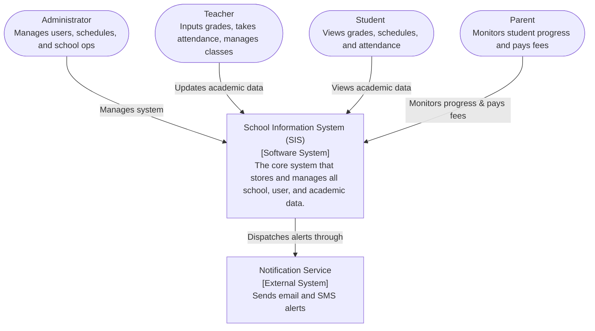
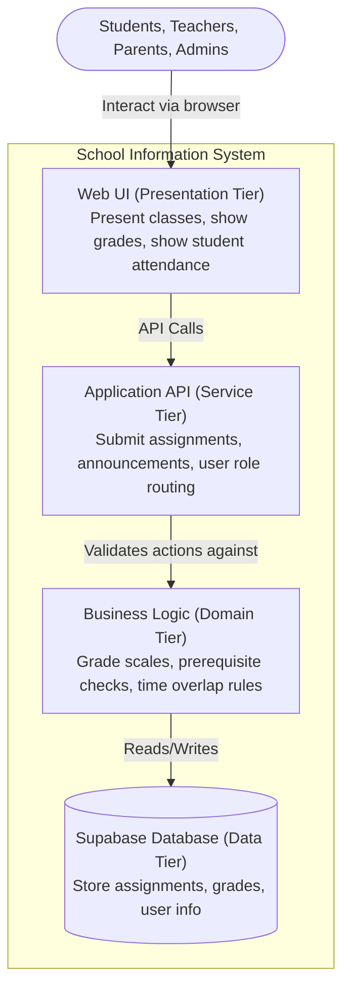
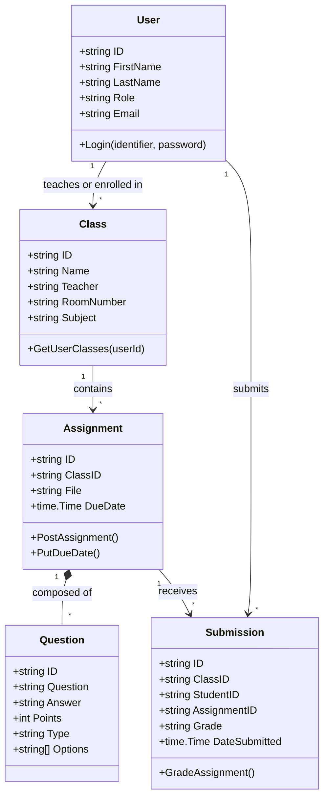
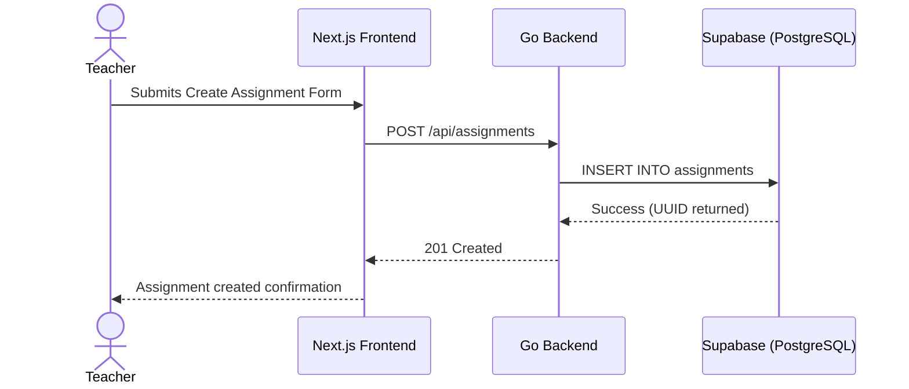

# [School Information System]

<!-- CI badge: after Session 4, replace ORG/REPO and the workflow filename, then uncomment:

-->

**Student:** Joseph Gabrie · **Course:** CEN 5064 Software Design, Fall 2026 · **Partner:** @Jesse-Trueba

## Project (approval paragraph — write this by Sun Aug 30)

My project is a school information system (SIS) built for a k-8 school. 
The features that it needs to have are:
1. AI submission detection System
2. Attendance system
3. Assignment/Quiz system
4. Notification System

My tech stack uses Next.js (React) for my FrontEnd, Golang for my backend, and Supabase for my Database.
## Prerequisites & Installation Requirements

Depending on how you run the application, make sure you have the following installed on your computer/laptop:

### Method A: Running with Docker (Recommended for quick testing)
Docker packages all dependencies (Go, Node.js, libraries) into self-contained environments, so you do not need to install Go or Node locally.
- **[Docker Desktop](https://www.docker.com/products/docker-desktop/)** (macOS / Windows / Linux) or **Docker Engine** (Linux).
- **Docker Compose** (comes bundled with Docker Desktop or `docker-compose-plugin` on Linux).
- Verify your installation:
  ```bash
  docker --version
  docker compose version
  ```
- *(Optional)* **Make** (pre-installed on macOS/Linux; on Windows available via Git Bash, WSL, or Chocolatey) if using the `make docker-*` convenience targets.

---

### Method B: Running Locally (Native Development without Docker)
To run the services directly on your operating system without containers, install the following:

1. **Go (Golang)**:
   - Required version: **1.22+** (1.24+ recommended)
   - Install from [go.dev/dl](https://go.dev/dl/) or via package managers (`brew install go`, `sudo apt install golang`, `winget install GoLang.Go`).
   - Verify installation:
     ```bash
     go version
     ```

2. **Node.js & npm**:
   - Required version: **Node.js 20 LTS** or **22 LTS** (npm 10+ is included).
   - Install from [nodejs.org](https://nodejs.org/) or via `nvm` (`nvm install 22`).
   - Verify installation:
     ```bash
     node -v
     npm -v
     ```

3. **Git**:
   - Required to clone and version the codebase.
   - Verify installation:
     ```bash
     git --version
     ```

4. *(Optional)* **Kitty Terminal Emulator**:
   - Only needed if using the legacy `make run_student`, `make run_teacher`, etc. targets on Linux, which open separate Kitty windows. Otherwise, standard terminal windows work for running the backend and frontend.

---

## How to run

### Option 1: Running with Docker (Recommended for testing on other computers/laptops)

No need to have Go or Node.js installed locally—only Docker and Docker Compose.

1. **Set up Environment Variables**:
   ```bash
   cp .env.example .env
   ```

2. **Start Backend & Frontend**:
   ```bash
   docker compose up --build
   ```
   *(Or run in background with `docker compose up --build -d` or `make docker-up`)*

3. **Access the application**:
   - **Frontend UI:** [http://localhost:3000](http://localhost:3000)
   - **Backend API:** [http://localhost:6769](http://localhost:6769)

4. **Stop the containers**:
   ```bash
   docker compose down
   # or
   make docker-down
   ```

### Option 2: Running locally without Docker

```bash
# Terminal 1: Backend
cd backend
# Ensure .env is set with SUPABASE_CONNECTION_STRING
go run ./main/main.go

# Terminal 2: Frontend
cd frontend
npm install
npm run dev
```

### Test User Credentials

| Role | Identifier | Password |
|---|---|---|
| **Student** | `438813` | `041210SS` |
| **Teacher** | `31229834` | `082580TT` |
| **Admin** | `31864322` | `113075AA` |
| **Parent** | `76633852` | `021485PP` |

## Architecture
### Tier breakdown (Session 2 studio)

| Tier | What it does in THIS system | Folders & Files |
|---|---|---|
| **Presentation** | Renders user interfaces and handles user interactions for students, teachers, parents, and administrators. Manages client-side routing, form state, and authentication context. Displays role-based dashboards, class schedules, assignments, submissions, and grades. | `frontend/app/` (pages & layouts: `page.tsx`, `profile/page.tsx`, `calendar/page.tsx`, `class/[classId]/page.tsx`, `teacher/assignments/`), `frontend/components/dashboards/` (`AdminDashboard.tsx`, `TeacherDashboard.tsx`, `StudentDashboard.tsx`), `frontend/components/assignments/` (`CreateAssignmentForm.tsx`), `frontend/components/ui/` (Shadcn UI components: `button.tsx`, `card.tsx`, `sidebar.tsx`), `frontend/components/` (`auth-guard.tsx`, `role-guard.tsx`, `class-card.tsx`, `app-sidebar.tsx`), `frontend/contexts/AuthContext.tsx` |
| **Service** | Orchestrates application workflow, handles incoming HTTP REST API requests, validates request payloads, manages authentication/JWT authorization tokens, and coordinates interactions between domain logic and the database. Exposes endpoints for user login, class rosters, assignment creation/retrieval/updates, and submission intake. | `backend/main/main.go` (Fiber server setup, CORS, route registration), `backend/auth/signIn.go` (HTTP endpoint `POST /api/login/`, JWT creation), `backend/auth/middleware.go` (route authorization checks), `backend/api/handler.go` (dashboard endpoints `GET :userId/dashboard`), `backend/assignments/handlers.go` (REST handlers: `postAssignment`, `getAssignment`, `putAssignment`, `putDueDate`, `postSubmission`, `getSubmission`, `getUserAssignments`, `getClassAssignments`) |
| **Domain** | Encapsulates core school business rules, grading policies, and entity models independently of HTTP transport or database storage. Enforces grading logic: auto-grades objective questions (multiple choice, true/false, fill-in-the-blank), assigns a grade of `0` to late submissions submitted past the deadline, and flags free-form or file-based submissions as "Needs Manual Grading". | `backend/assignments/grading.go` — Contains `GradeAssignment()`: Implements core business grading rules for evaluating student submissions against assignment deadlines and questions.<br>`backend/assignments/grading_test.go` (Pure unit tests verifying grading business rules without DB/network mocks), `backend/assignments/models.go` (Domain models: `Assignment`, `Question`, `Submission`, `StudentAnswer`), `backend/auth/signIn.go` (`VerifyPassword()` bcrypt check) |
| **Data** | Manages persistent data storage, database connection pooling, schema migrations, table constraints, and SQL queries for users, classes, enrollments, assignments, and submissions. Connects to hosted PostgreSQL on Supabase via `pgxpool`. | Supabase Cloud Database (PostgreSQL database & assignment file storage buckets), `backend/main/main.go` (`connect()` initializing `pgxpool.Pool` via `SUPABASE_CONNECTION_STRING`), `backend/init_assignments.sql` (schema definitions for `assignments` and `submissions`), SQL queries in `backend/assignments/handlers.go`, `backend/api/handler.go`, and `backend/auth/signIn.go`, `.env` (`SUPABASE_CONNECTION_STRING`) |

### C4 — Context & Container (Session 3 studio)




### UML — Class & Sequence (Session 3 studio)





## Architecture Decision Records

Decisions live in [`docs/adr/`](docs/adr/). Start with ADR-001 in Session 4.

| # | Decision | Status |
|---|----------|--------|
| [001](docs/adr/adr-001.md) | Architecture and Tech Stack Selection for K-8 School Information System | accepted |
| [002](docs/adr/adr-002.md) | Data Storage Choice: Transition from Local PostgreSQL to Supabase | accepted |

## Weekly log (optional but recommended)

A one-line note per week keeps your commit story readable:

- Week 1 (Aug 24): repo created, three ideas drafted
- Week 2 (Aug 31): initial structure
- September 21: Working on user dashboard
- October 2: Created a page for each class and fixed routing issues
- October 6: Attached assignment creation tool to teacher class assignments section and fixed assignment form bugs
