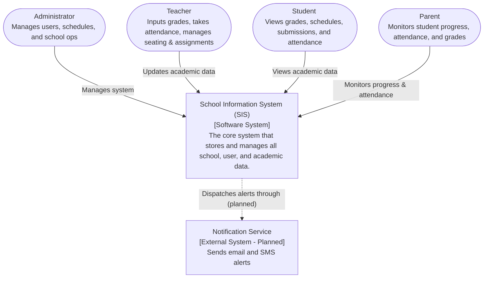
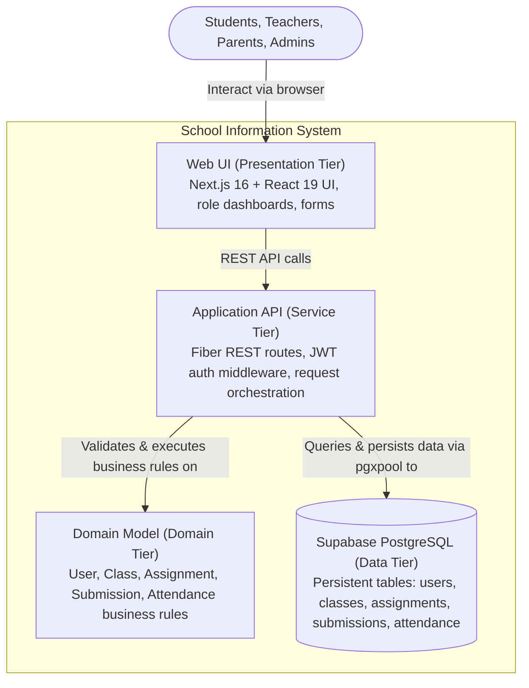
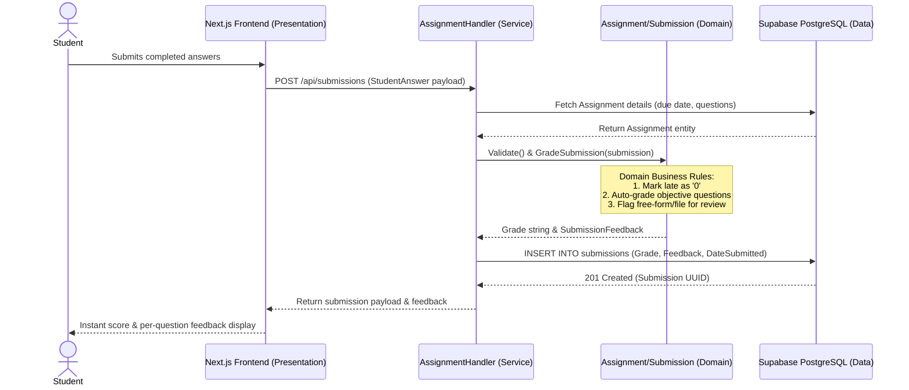

# [School Information System]

<!-- CI badge: after Session 4, replace ORG/REPO and the workflow filename, then uncomment:

-->

**Student:** Joseph Gabrie · **Course:** CEN 5064 Software Design, Fall 2026 · **Partner:** @Jesse-Trueba

## Project (approval paragraph — write this by Sun Aug 30)

My project is a school information system (SIS) built for a k-8 school. 
The features that it needs to have are:
1. AI submission detection System
2. Attendance system
3. Assignment/Quiz system
4. Notification System

My tech stack uses Next.js (React) for my FrontEnd, Golang for my backend, and Supabase for my Database.
## Prerequisites & Installation Requirements

Depending on how you run the application, make sure you have the following installed on your computer/laptop:

### Method A: Running with Docker (Recommended for quick testing)
Docker packages all dependencies (Go, Node.js, libraries) into self-contained environments, so you do not need to install Go or Node locally.
- **[Docker Desktop](https://www.docker.com/products/docker-desktop/)** (macOS / Windows / Linux) or **Docker Engine** (Linux).
- **Docker Compose** (comes bundled with Docker Desktop or `docker-compose-plugin` on Linux).
- Verify your installation:
  ```bash
  docker --version
  docker compose version
  ```
- *(Optional)* **Make** (pre-installed on macOS/Linux; on Windows available via Git Bash, WSL, or Chocolatey) if using the `make docker-*` convenience targets.

---

### Method B: Running Locally (Native Development without Docker)
To run the services directly on your operating system without containers, install the following:

1. **Go (Golang)**:
   - Required version: **1.22+** (1.24+ recommended)
   - Install from [go.dev/dl](https://go.dev/dl/) or via package managers (`brew install go`, `sudo apt install golang`, `winget install GoLang.Go`).
   - Verify installation:
     ```bash
     go version
     ```

2. **Node.js & npm**:
   - Required version: **Node.js 20 LTS** or **22 LTS** (npm 10+ is included).
   - Install from [nodejs.org](https://nodejs.org/) or via `nvm` (`nvm install 22`).
   - Verify installation:
     ```bash
     node -v
     npm -v
     ```

3. **Git**:
   - Required to clone and version the codebase.
   - Verify installation:
     ```bash
     git --version
     ```

4. *(Optional)* **Kitty Terminal Emulator**:
   - Only needed if using the legacy `make run_student`, `make run_teacher`, etc. targets on Linux, which open separate Kitty windows. Otherwise, standard terminal windows work for running the backend and frontend.

---

## How to run

### Option 1: Running with Docker (Recommended for testing on other computers/laptops)

No need to have Go or Node.js installed locally—only Docker and Docker Compose.

1. **Set up Environment Variables**:
   ```bash
   cp .env.example .env
   ```

2. **Start Backend & Frontend**:
   ```bash
   docker compose up --build
   ```
   *(Or run in background with `docker compose up --build -d` or `make docker-up`)*

3. **Access the application**:
   - **Frontend UI:** [http://localhost:3000](http://localhost:3000)
   - **Backend API:** [http://localhost:6769](http://localhost:6769)

4. **Stop the containers**:
   ```bash
   docker compose down
   # or
   make docker-down
   ```

### Option 2: Running locally without Docker

```bash
# Terminal 1: Backend
cd backend
# Ensure .env is set with SUPABASE_CONNECTION_STRING
go run ./main/main.go

# Terminal 2: Frontend
cd frontend
npm install
npm run dev
```

### Test User Credentials

| Role | Identifier | Password |
|---|---|---|
| **Student** | `438813` | `041210SS` |
| **Teacher** | `31229834` | `082580TT` |
| **Admin** | `31864322` | `113075AA` |
| **Parent** | `76633852` | `021485PP` |

## Architecture
### Tier breakdown (Session 2 studio)

| Tier | What it does in THIS system | Folders & Files |
|---|---|---|
| **Presentation** | Renders user interfaces and handles user interactions for students, teachers, parents, and administrators. Manages client-side routing, form state, and authentication context. Displays role-based dashboards, class schedules, assignments, submissions, instant grading feedback, and attendance grids. | `frontend/app/` (pages & layouts: `page.tsx`, `profile/page.tsx`, `calendar/page.tsx`, `class/[classId]/page.tsx`, `teacher/assignments/create/page.tsx`), `frontend/components/dashboards/` (`AdminDashboard.tsx`, `TeacherDashboard.tsx`, `StudentDashboard.tsx`, `ParentDashboard.tsx`), `frontend/components/assignments/` (`CreateAssignmentForm.tsx`, `StudentAssignmentView.tsx`), `frontend/components/attendance/` (`ClassroomAttendanceManager.tsx`), `frontend/components/ui/` (Shadcn UI components: `button.tsx`, `card.tsx`, `sidebar.tsx`, `sheet.tsx`, `calendar.tsx`), `frontend/components/` (`auth-guard.tsx`, `role-guard.tsx`, `class-card.tsx`, `app-sidebar.tsx`), `frontend/contexts/AuthContext.tsx` |
| **Service** | Orchestrates application workflows, processes incoming HTTP REST requests, enforces JWT authorization tokens, and coordinates domain rules with data persistence. Exposes endpoints for user authentication, class rosters, assignment publishing/updates, submission auto-grading, daily attendance, seating layout, and parent overview. | `backend/main/main.go` (Fiber server setup, CORS, route registration), `backend/auth/signIn.go` (HTTP endpoint `POST /api/login/`, JWT creation), `backend/auth/middleware.go` (`RequiredLogin`, `RequiredRoles` authorization checks), `backend/api/handler.go` (`GetUserClassess` route setup), `backend/assignments/handlers.go` (REST handlers: `postAssignment`, `getAssignment`, `putAssignment`, `putDueDate`, `postSubmission`, `getSubmission`, `putSubmissionGrade`, `getClassAssignments`, `getClassSubmissions`), `backend/attendance/handlers.go` (`SetupAttendanceAndPortalRoutes`, roster, seating, attendance logs, announcements, parent overview) |
| **Domain** | Encapsulates core school business rules, grading policies, seating constraints, and domain entities independently of HTTP transport or database storage. Enforces grading logic: auto-grades objective questions, assigns a grade of `0` to late submissions submitted past the deadline, flags free-form or file-based submissions as "Needs Manual Grading", validates attendance status, and enforces non-overlapping seating charts. Every domain rule has 100% unit test coverage without mocks. | `backend/auth/models.go` (`User` entity: `Validate()`, `HasRole()`, `FullName()`, `VerifyPassword()`), `backend/auth/auth_test.go` (User domain rule tests),<br>`backend/api/handler.go` (`Class` entity: `Validate()`, `MatchesSubject()`), `backend/api/class_test.go` (Class domain tests),<br>`backend/assignments/models.go` (`Assignment`: `Validate()`, `IsLate()`, `TotalPoints()`, `GradeSubmission()`, `EvaluateFeedback()`; `Question`: `Validate()`, `EvaluateAnswer()`; `Submission`: `Validate()`, `GradeAssignment()`, `GetAnswerForQuestion()`),<br>`backend/assignments/grading.go` (`GradeAssignment()`, `EvaluateSubmissionFeedback()`), `backend/assignments/grading_test.go` (Domain grading and entity tests),<br>`backend/attendance/models.go` (`AttendanceRecord`: `Validate()`, `NormalizeStatus()`), `backend/attendance/service.go` (`CalculateAttendanceSummary()`, `ValidateAttendanceStatus()`, `ValidateSeatingPlan()`, `GroupAttendanceByDate()`), `backend/attendance/attendance_test.go` (Attendance & seating domain tests) |
| **Data** | Manages persistent data storage, database connection pooling, schema migrations, table constraints, and SQL queries for users, classes, enrollments, assignments, submissions, attendance records, and seating charts. Connects to hosted PostgreSQL on Supabase via `pgxpool.Pool`. Data survives restarts indefinitely. | Supabase Cloud Database (PostgreSQL database & assignment file storage buckets), `backend/main/main.go` (`connect()` initializing `pgxpool.Pool` via `SUPABASE_CONNECTION_STRING`), `backend/init_assignments.sql` (schema definitions for `assignments` and `submissions`), `backend/init_attendance.sql` (schema definitions for `attendance_records` and `seating_assignments`), SQL queries in `backend/assignments/handlers.go`, `backend/attendance/handlers.go`, `backend/api/handler.go`, and `backend/auth/signIn.go`, `.env` (`SUPABASE_CONNECTION_STRING`) |

### C4 — Context & Container (Session 3 studio)




### UML — Class & Sequence (Session 3 studio)

```mermaid
%% Class diagram: core domain classes, methods, and planned features.
classDiagram
    class User {
        +string ID
        +string FirstName
        +string LastName
        +string Role
        +string Email
        +Validate() error
        +HasRole(role) bool
        +FullName() string
        +VerifyPassword(password) error
    }

    class Class {
        +string ID
        +string Name
        +string Teacher
        +string Room_Number
        +string Subject
        +Validate() error
        +MatchesSubject(subject) bool
    }

    class Assignment {
        +string ID
        +string ClassID
        +string File
        +time.Time DueDate
        +Validate() error
        +IsLate(submittedAt) bool
        +TotalPoints() int
        +GradeSubmission(submission) string
        +EvaluateFeedback(submission) SubmissionFeedback
    }

    class Question {
        +string ID
        +string Question
        +string Answer
        +int Points
        +string Type
        +string[] Options
        +Validate() error
        +EvaluateAnswer(studentAns) tuple
    }

    class Submission {
        +string ID
        +string ClassID
        +string StudentID
        +string AssignmentID
        +string Grade
        +time.Time DateSubmitted
        +Validate() error
        +GradeAssignment(assignment) string
        +GetAnswerForQuestion(questionId) string
    }

    class AttendanceRecord {
        +string ID
        +string ClassID
        +string StudentID
        +string Date
        +string Status
        +string Notes
        +Validate() error
        +NormalizeStatus() string
    }

    class SeatAssignment {
        +string ID
        +string ClassID
        +string StudentID
        +int Row
        +int Col
    }

    class AISubmissionDetector {
        <<planned>>
        +ScanSubmission(text) float
        +FlagPlagiarism(threshold) bool
    }

    class NotificationService {
        <<planned>>
        +SendEmailAlert(to, subject, body)
        +SendSMSAlert(to, message)
    }

    User "1" --> "*" Class : teaches or enrolled in
    Class "1" --> "*" Assignment : contains
    Assignment "1" *-- "*" Question : composed of
    User "1" --> "*" Submission : submits
    Assignment "1" --> "*" Submission : receives
    Class "1" --> "*" AttendanceRecord : tracks daily
    Class "1" --> "*" SeatAssignment : maps layout
    AISubmissionDetector ..> Submission : evaluates (planned)
    NotificationService ..> User : alerts (planned)

    style AISubmissionDetector stroke-dasharray: 5 5
    style NotificationService stroke-dasharray: 5 5
```



## Architecture Decision Records

Decisions live in [`docs/adr/`](docs/adr/). Start with ADR-001 in Session 4.

| # | Decision | Status |
|---|----------|--------|
| [001](docs/adr/adr-001.md) | Architecture and Tech Stack Selection for K-8 School Information System | accepted |
| [002](docs/adr/adr-002.md) | Data Storage Choice: Transition from Local PostgreSQL to Supabase | accepted |

---

## Project Plan & Risks

### Week-by-Week Development Plan

| Week & Dates | Objectives & Focus | Core Deliverables | Status |
|---|---|---|---|
| **Week 1** (Aug 24 – Aug 30) | Project initiation & scope definition | Repo initialization, three ideas drafted, initial proposal approval paragraph | **Completed** |
| **Week 2** (Aug 31 – Sep 6) | Baseline architecture & environment scaffolding | Repository structure, Next.js frontend setup, Go Fiber backend setup, Docker config | **Completed** |
| **Week 3** (Sep 7 – Sep 13) | 4-tier architectural planning | Tier breakdown table (Presentation, Service, Domain, Data) and ADR-001 drafting | **Completed** |
| **Week 4** (Sep 14 – Sep 20) | Architectural modeling & database setup | C4 Context & Container diagrams, initial UML diagrams, Supabase PostgreSQL schema | **Completed** |
| **Week 5** (Sep 21 – Sep 27) | Authentication & role-based routing | User authentication, bcrypt password hashing, JWT creation/verification, role guards | **Completed** |
| **Week 6** (Sep 28 – Oct 4) | Class dashboards & dynamic routing | Class roster database queries, class cards, dynamic class page routing (`/class/[classId]`) | **Completed** |
| **Week 7** (Oct 5 – Oct 11) | Assignment creation & domain grading | Assignment domain models, Zod validation schema, TDD domain grading engine, teacher form | **Completed** |
| **Week 8** (Oct 12 – Oct 18) | Assignment dashboard & midterm review | Active/past-due assignment lists, due date modal editor, Midterm peer review round | **Completed** |
| **Week 9** (Oct 19 – Oct 25) | Instant auto-grading feedback engine | Per-question feedback breakdown, instant score reporting, student submission viewer | **Completed** |
| **Week 10** (Oct 26 – Nov 1) | Attendance management & Parent Portal | Interactive seating chart manager, attendance logs (present/absent/tardy), Parent Portal overview | **Completed** |
| **Week 11** (Nov 2 – Nov 8) | Domain rule refactoring & diagram sync | Strict 4-tier domain refactoring, UML diagram synchronization with `<<planned>>` borders, AI critique blocks | **Completed** |
| **Week 12** (Nov 9 – Nov 15) | Final peer review & integration testing | End-to-end integration tests, CI workflow verification, cross-platform Docker run check | **In Progress** |
| **Week 13** (Nov 16 – Nov 22) | Final release & documentation freeze | Final presentation demo, documentation audit, rubric validation, final submission | **Planned** |

### Risk Register & Handling Strategies

| Risk ID | Risk Description | Category | Likelihood | Impact | How We Handle It (Mitigation & Response Strategy) |
|---|---|---|---|---|---|
| **RSK-01** | **Remote Database Latency or Connection Dropouts** | Technical | Medium | High | Use connection pooling via `pgxpool.Pool` with connection timeouts and auto-reconnects. Maintain seed data scripts (`init_assignments.sql`, `init_attendance.sql`) and ensure health checks return clear errors if Supabase is temporarily unreachable. |
| **RSK-02** | **Business Rule Leakage across Tier Boundaries** | Architecture | Medium | High | Enforce strict 4-tier separation: all business logic (grading formulas, late penalties, attendance rate calculation, seating grid collisions, role validation) is implemented as pure methods on Domain structs with 100% unit test coverage in Go. Controllers only parse HTTP and invoke domain methods. |
| **RSK-03** | **Diagram and Code Drift** | Architecture | High | Medium | All classes and methods displayed in UML class diagrams directly match Go structs and methods. Unbuilt or external systems (`AISubmissionDetector`, `NotificationService`) are explicitly marked with `<<planned>>` and dashed borders (`stroke-dasharray: 5 5`). |
| **RSK-04** | **AI-Generated Code Errors or Hallucinations** | Quality | High | Medium | Enforce mandatory **AI Critique Blocks** in `.github/pull_request_template.md` and `agent_documentation.md`. Every PR using AI explicitly records what was checked, what was wrong (e.g. unmounted routes, wrong form validation, timezone drift), and what was fixed or kept. |
| **RSK-05** | **Environment Disparities on Evaluation Day** | Operations | Medium | High | Containerize the complete application stack with Docker and Docker Compose. Provide a single turnkey command (`docker compose up --build`) that pins Node 20 LTS and Go 1.24+, guaranteeing identical runtime behavior on any clean clone. |
| **RSK-06** | **Scope Creep across Multi-Role Portals** | Project | Medium | Medium | Maintain explicit "Done when" checklists on every GitHub issue and PR. Prioritize the core K-8 features (Assignments, Instant Auto-Grading, Attendance, Parent/Teacher/Student dashboards) while keeping AI plagiarism scanning and SMS alerting explicitly documented as planned future extensions. |

---

## Weekly log

A one-line note per week keeps your commit story readable:

- Week 1 (Aug 24): repo created, three ideas drafted
- Week 2 (Aug 31): initial structure and basic routing
- September 21: Working on user dashboard and authentication
- October 2: Created a page for each class and fixed routing issues
- October 6: Attached assignment creation tool to teacher class assignments section and fixed assignment form bugs
- October 12: Implemented assignment dashboard with active/past due list and editing capabilities
- October 21: Added instant auto-grading feedback engine, seating chart manager, and Parent Portal
- November 4: Refactored domain business rules into domain entities with unit tests, synchronized UML diagrams with planned borders, added week-by-week plan and risk register, and documented AI critique blocks

