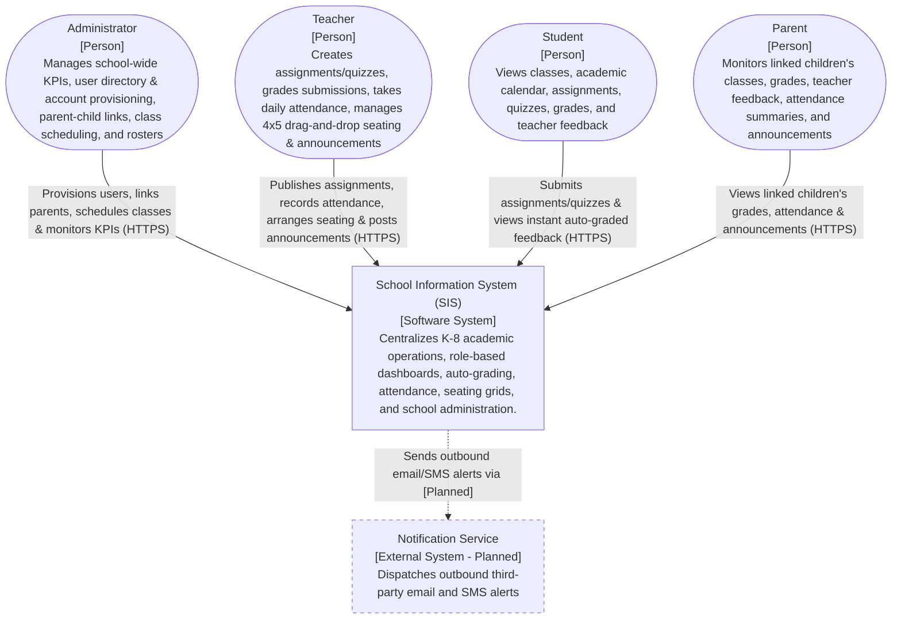
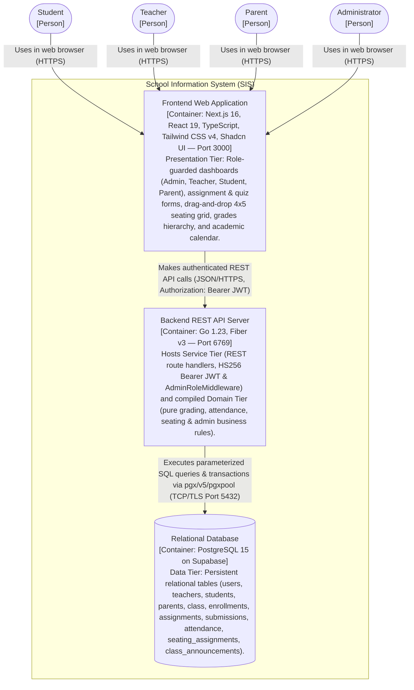
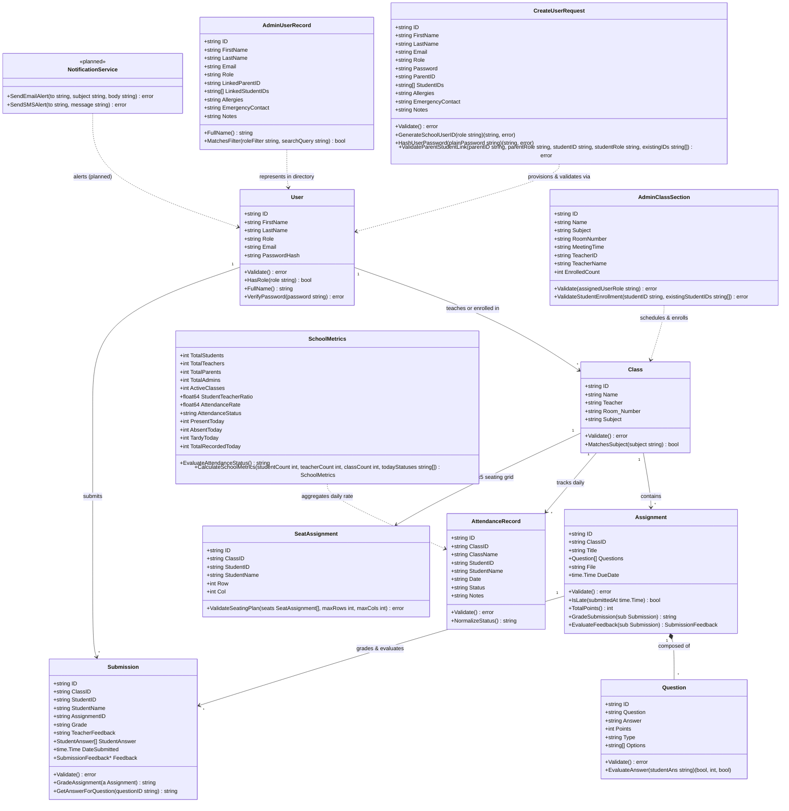
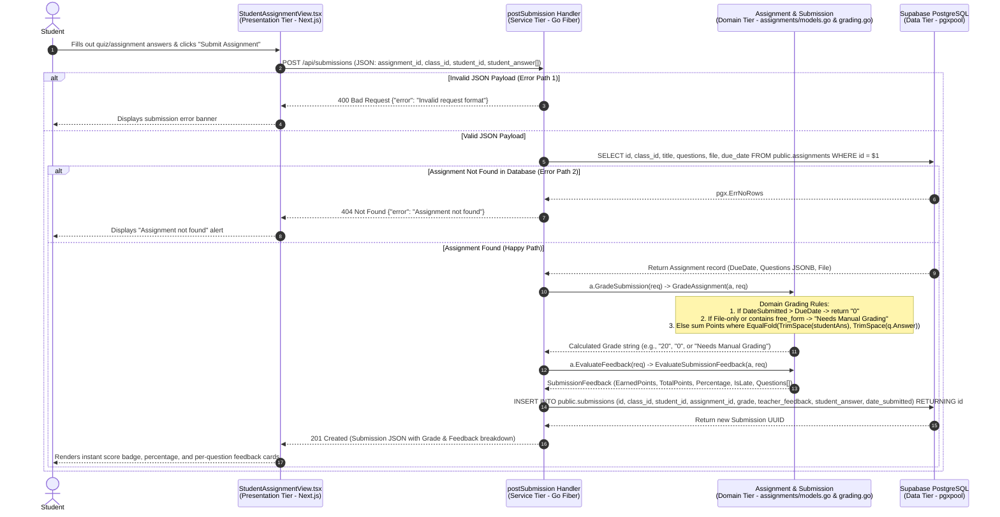

# [School Information System]

<!-- CI badge: after Session 4, replace ORG/REPO and the workflow filename, then uncomment:

-->

**Student:** Joseph Gabrie · **Course:** CEN 5064 Software Design, Fall 2026 · **Partner:** @Jesse-Trueba

## Project (approval paragraph — write this by Sun Aug 30)

My project is a School Information System (SIS) built for a K-8 school.
The core features of the system are:
1. **Admin Dashboard & School Management System** (school-wide KPI metrics, class section scheduling, student roster enrollment, user directory provisioning, and parent-student account linking)
2. **Attendance & Interactive Seating System** (daily present/absent/tardy tracking, historical attendance logs, and an interactive 4×5 classroom seating chart)
3. **Assignment, Quiz & Instant Auto-Grading System** (custom multi-question quizzes and file assignments, automatic grading with late-submission enforcement, per-question feedback, and manual teacher grade overrides)
4. **Class Announcement & Parent Portal System** (class-level announcements, unified academic calendar, and a dedicated Parent Portal aggregating linked children's classes, grades, attendance summaries, and announcements)

My tech stack uses **Next.js (React + TypeScript)** for the Frontend, **Golang (Fiber)** for the Backend, and **Supabase (PostgreSQL)** for the Database.

---

## Project Scope

### Written Scope Statement
The **K-8 School Information System (SIS)** is a full-stack, role-based web application designed to centralize daily academic and administrative operations for elementary and middle schools. The platform serves four distinct authenticated roles—**Students**, **Teachers**, **Parents**, and **Administrators**—through a strict 4-tier architecture (Presentation, Service, Domain, and Data).

#### In-Scope (Implemented & Connected Features)
1. **Authentication & Role-Based Access Control (RBAC)**:
   - Credential login (`POST /api/login/`) supporting numeric school User IDs or email addresses verified against `bcrypt` password hashes.
   - Signed HS256 JWT issuance and verification (`Authorization: Bearer <token>`), enforcing server-side role checks (`AdminRoleMiddleware`, `RequiredLogin`, `RequiredRoles`) so clients cannot spoof roles via custom headers.
2. **Admin Dashboard & School-Wide Management (`/api/admin/*`)**:
   - **School-Wide KPI Overview**: Real-time calculation of total students, teachers, parents, admins, active classes, student-to-teacher ratio, and daily attendance rate with health classifications (`Healthy`, `Moderate`, `Needs Attention`, `No Records Today`).
   - **Class Section & Roster Management**: Creating class sections (`POST /api/admin/classes`) with `class_name`, `subject`, `room_number`, `meeting_time`, and searchable teacher assignment, plus enrolling/removing students (`POST /api/admin/classes/:classId/enroll`, `DELETE /api/admin/classes/:classId/enroll/:studentId`) with domain validation preventing duplicate enrollments.
   - **User Directory & Account Provisioning**: Searchable and role-filterable user directory (`GET /api/admin/users`), account creation (`POST /api/admin/users`) with cryptographically generated role-based IDs (`6-digit` for students, `8-digit` for staff/parents) and `bcrypt` password hashing, immediate attachment of parents, `allergies`, `emergency_contact`, and `notes` when creating students (or attaching children when creating parents), and searchable parent-to-student linkage (`POST /api/admin/parent-links`).
3. **Assignment, Quiz & Auto-Grading Engine (`/api/assignments/*`, `/api/submissions/*`)**:
   - Teachers can create named assignments and quizzes (`title`), edit questions, and manage due dates for both interactive multi-question quizzes and document-based assignments.
   - Pure domain auto-grading (`GradeAssignment` & `EvaluateSubmissionFeedback`) that scores objective questions, enforces a `0` score on late submissions (`IsLate`), flags free-form or file submissions as `"Needs Manual Grading"`, and allows teachers to update grades and optional written review feedback (`teacher_feedback` via `PUT /api/submissions/:id/grade`).
   - Hierarchical **Grades & Feedback** view displaying students with their overall grades first, expanding on click to show each student's submitted assignments and teacher review feedback.
4. **Classroom Attendance & Interactive Drag-and-Drop Seating Grid (`/api/classes/:classId/attendance`, `/api/classes/:classId/seating`)**:
   - Interactive 4×5 drag-and-drop classroom seating grid allowing teachers to drag students from the class roster onto desks or swap desks with domain collision detection (`ValidateSeatingPlan`).
   - Daily attendance recording (`present`, `absent`, `tardy`) with per-student notes and historical daily logs, restricted to teachers, parents, and administrators (not viewable by students).
5. **Class Announcements, Calendar & Parent Portal (`/api/classes/:classId/announcements`, `/api/parents/:parentId/overview`)**:
   - Teachers and admins can post class announcements visible on class pages and dashboards, and named assignments appear on the academic calendar.
   - Unified Parent Portal displaying all linked children along with their enrolled classes, assignment grades and teacher feedback, attendance rates, and teacher announcements.

#### Out-of-Scope & Scope Adjustments
- **Replaced AI Plagiarism Detection with Admin Dashboard**: During initial ideation, an AI submission/plagiarism detector was considered. That feature was formally scrapped and replaced with the **Admin Dashboard & School Management System** so the SIS provides complete institutional administration (school metrics, user provisioning, parent-child linking, and class/roster management).
- **External Email/SMS Gateways**: In-app announcements and portal notifications are fully implemented; outbound third-party SMTP/SMS messaging (`NotificationService`) remains out of scope for the core classroom release.
- **Tuition Billing, Payroll & Bus Routing**: Financial accounting and transportation logistics are outside the academic scope of this K-8 SIS.

---

## Database Setup & Configuration

The backend uses **PostgreSQL** hosted on **Supabase** (accessed via `jackc/pgx/v5/pgxpool`). All schema definitions and seed utilities are located in the [`backend/`](backend/) directory.

### 1. Create a Supabase Project & Get Connection String
1. Create a new project at [supabase.com](https://supabase.com) (or use an existing PostgreSQL 15+ instance).
2. In the Supabase Dashboard, navigate to **Project Settings → Database → Connection string** and copy the **Transaction/Session Pooler URI** (port `5432` or `6543`).
3. Copy `.env.example` to `.env` in the repository root and set your credentials (never commit `.env` to git):
   ```bash
   cp .env.example .env
   ```
   Required variables in `.env`:
   ```env
   SUPABASE_CONNECTION_STRING=postgresql://postgres.<project-id>:<db-password>@aws-0-<region>.pooler.supabase.com:5432/postgres
   JWT_SECRET=your_strong_jwt_signing_secret
   ```

### 2. Initialize the Database Schema
Run the master schema script [`backend/init_schema.sql`](backend/init_schema.sql) in the **Supabase SQL Editor** (or via `psql "$SUPABASE_CONNECTION_STRING" -f backend/init_schema.sql`). Modular feature scripts ([`backend/init_assignments.sql`](backend/init_assignments.sql) and [`backend/init_attendance.sql`](backend/init_attendance.sql)) are also included.

| Table Name | Primary Key | Purpose & Relationships |
|---|---|---|
| `public.users` | `"ID"` (`BIGINT`) | Stores all accounts across roles (`student`, `teacher`, `parent`, `admin`), `bcrypt` password hashes (`password_hash`), names, emails, birthdays, and addresses. |
| `public.teachers` | `id` (`BIGSERIAL`) | Links teacher profile records to `public.users("ID")` (`user_id`). |
| `public.students` | `id` (`BIGSERIAL`) | Links student profile records to `public.users("ID")` (`user_id`), optional parent account `parent_id` (`public.users("ID")`), `allergies`, `emergency_contact`, and `notes`. |
| `public.parents` | `id` (`BIGSERIAL`) | Links parent profile records to `public.users("ID")` (`user_id`) and contact/address metadata. |
| `public.class` | `id` (`BIGSERIAL`) | Stores class sections (`class_name`, `subject`, `room_number`, `meeting_time`) and assigned `teacher_id` (`public.teachers(id)`). |
| `public.enrollments` | `id` (`BIGSERIAL`) | Many-to-many join table linking `class_id` (`public.class`) and `student_id` (`public.students`) with `UNIQUE (class_id, student_id)`. |
| `public.assignments` | `id` (`UUID`) | Stores class assignments and quizzes (`class_id`, `title`, `questions` JSONB array, `file`, `due_date`). |
| `public.submissions` | `id` (`UUID`) | Stores student submissions (`assignment_id`, `student_id`, `class_id`, `grade`, `teacher_feedback`, `student_answer` JSONB, `date_submitted`). |
| `public.attendance` | `id` (`UUID`) | Stores daily attendance records (`class_id`, `student_id`, `date`, `status` in `present`/`absent`/`tardy`, `notes`) with `UNIQUE (class_id, student_id, date)`. |
| `public.seating_assignments` | `id` (`BIGSERIAL`) | Stores classroom grid coordinates (`class_id`, `student_id`, `row`, `col`) with uniqueness constraints per seat and student. |
| `public.class_announcements` | `id` (`BIGSERIAL`) | Stores teacher/admin announcements (`class_id`, `"Title"`, `content`, `date`, `created_at`). |

### 3. Seed Initial Users (Without Committing Passwords)
To keep credentials out of version control, `backend/users.json` and `.env` are gitignored.
1. Copy the template file [`backend/users.example.json`](backend/users.example.json) to `backend/users.json` and fill in your desired test users:
   ```bash
   cp backend/users.example.json backend/users.json
   ```
2. Run the user generator script from `backend/main/scripts/`:
   ```bash
   cd backend/main/scripts
   go run generateUser.go
   ```
   - **How `generateUser.go` works**: It generates a cryptographically random 6-digit ID for students (`100000–999999`) or 8-digit ID for teachers/parents/admins (`10000000–99999999`), derives the initial password from the user's birthday and uppercase initials (`MMDDYY` + `<FirstInitial><LastInitial>`), hashes the password with `bcrypt`, and inserts the records into `public.users`, `public.students`, and `public.teachers`.
   - Alternatively, once logged in as an Administrator, you can create new Student, Teacher, Parent, and Admin accounts directly from the **Admin Dashboard → User Management Directory**.

---

## Prerequisites & Installation Requirements

Depending on how you run the application, make sure you have the following installed on your computer/laptop:

### Method A: Running with Docker (Recommended for quick testing)
Docker packages all dependencies (Go, Node.js, libraries) into self-contained environments, so you do not need to install Go or Node locally.
- **[Docker Desktop](https://www.docker.com/products/docker-desktop/)** (macOS / Windows / Linux) or **Docker Engine** (Linux).
- **Docker Compose** (comes bundled with Docker Desktop or `docker-compose-plugin` on Linux).
- Verify your installation:
  ```bash
  docker --version
  docker compose version
  ```
- *(Optional)* **Make** (pre-installed on macOS/Linux; on Windows available via Git Bash, WSL, or Chocolatey) if using the `make docker-*` convenience targets.

---

### Method B: Running Locally (Native Development without Docker)
To run the services directly on your operating system without containers, install the following:

1. **Go (Golang)**:
   - Required version: **1.22+** (1.24+ recommended)
   - Install from [go.dev/dl](https://go.dev/dl/) or via package managers (`brew install go`, `sudo apt install golang`, `winget install GoLang.Go`).
   - Verify installation:
     ```bash
     go version
     ```

2. **Node.js & npm**:
   - Required version: **Node.js 20 LTS** or **22 LTS** (npm 10+ is included).
   - Install from [nodejs.org](https://nodejs.org/) or via `nvm` (`nvm install 22`).
   - Verify installation:
     ```bash
     node -v
     npm -v
     ```

3. **Git**:
   - Required to clone and version the codebase.
   - Verify installation:
     ```bash
     git --version
     ```

4. *(Optional)* **Kitty Terminal Emulator**:
   - Only needed if using the `make run_student`, `make run_teacher`, etc. targets on Linux, which read credentials from your local `.env` file and open separate Kitty windows. Otherwise, standard terminal windows work for running the backend and frontend.

---

## How to run

### Option 1: Running with Docker (Recommended for testing on other computers/laptops)

No need to have Go or Node.js installed locally—only Docker and Docker Compose.

1. **Set up Environment Variables**:
   ```bash
   cp .env.example .env
   # Edit .env with your SUPABASE_CONNECTION_STRING and JWT_SECRET
   ```

2. **Start Backend & Frontend**:
   ```bash
   docker compose up --build
   ```
   *(Or run in background with `docker compose up --build -d` or `make docker-up`)*

3. **Access the application**:
   - **Frontend UI:** [http://localhost:3000](http://localhost:3000)
   - **Backend API:** [http://localhost:6769](http://localhost:6769)

4. **Stop the containers**:
   ```bash
   docker compose down
   # or
   make docker-down
   ```

### Option 2: Running locally without Docker

```bash
# Terminal 1: Backend
cd backend
# Ensure .env is set with SUPABASE_CONNECTION_STRING and JWT_SECRET
go run ./main/main.go

# Terminal 2: Frontend
cd frontend
npm install
npm run dev
```

---

## Architecture

### 2.1 N-Tier Architecture Breakdown (Session 2 Studio)

| Tier | What it does in THIS system | Folders, Files & Classes in Repository |
|---|---|---|
| **Presentation** | Renders role-based user interfaces and handles user interactions for students, teachers, parents, and administrators. Manages client-side routing, form validation state (React Hook Form + Zod), and authentication context (`AuthContext`). Displays role-based dashboards (`AdminDashboard`, `TeacherDashboard`, `StudentDashboard`, `ParentDashboard`), class schedules, assignments, quiz interfaces, instant auto-grading feedback breakdowns, hierarchical student grade views, announcements, academic calendar events, and interactive 4×5 drag-and-drop seating/attendance grids. | `frontend/app/` (`page.tsx`, `layout.tsx`, `profile/page.tsx`, `calendar/page.tsx`, `class/[classId]/page.tsx`, `class/[classId]/assignments/page.tsx`, `class/[classId]/quizzes/page.tsx`, `class/[classId]/grades/page.tsx`, `class/[classId]/attendance/page.tsx`, `class/[classId]/announcements/page.tsx`, `teacher/assignments/create/page.tsx`), `frontend/components/dashboards/` (`AdminDashboard.tsx`, `TeacherDashboard.tsx`, `StudentDashboard.tsx`, `ParentDashboard.tsx`), `frontend/components/assignments/` (`CreateAssignmentForm.tsx`, `StudentAssignmentView.tsx`), `frontend/components/attendance/` (`ClassroomAttendanceManager.tsx`), `frontend/components/ui/` (Shadcn UI components), `frontend/components/` (`auth-guard.tsx`, `role-guard.tsx`, `sign-in-page.tsx`, `class-card.tsx`, `app-sidebar.tsx`), `frontend/contexts/AuthContext.tsx` |
| **Service** | Orchestrates application workflows, processes incoming HTTP REST requests via Go Fiber v3, enforces stateless signed HS256 Bearer JWT authentication and RBAC authorization (`AdminRoleMiddleware`, `RequiredLogin`, `RequiredRoles`), and coordinates pure Domain business rules with Data tier persistence. Exposes REST endpoints for user sign-in, school-wide admin KPIs and provisioning, class rosters, assignment publishing/editing, submission auto-grading and teacher review feedback, daily attendance recording, classroom seating plans, announcements, and parent multi-child overview aggregation. | `backend/main/main.go` (Fiber server initialization, CORS middleware, route mounting), `backend/auth/signIn.go` (`SetupAuthRoutes`, `POST /api/login/`, HS256 JWT generation), `backend/auth/middleware.go` (`RequiredLogin`, `RequiredRoles`), `backend/admin/handlers.go` (`SetupAdminRoutes`, `AdminRoleMiddleware`, `getSchoolMetrics`, `getTeachers`, `getStudents`, `getAdminClasses`, `postAdminClass`, `postEnrollStudent`, `deleteEnrollStudent`, `getAdminUsers`, `postAdminUser`, `postParentStudentLink`), `backend/api/handler.go` (`GetUserClassess`), `backend/assignments/handlers.go` (`SetupAssignmentRoutes`, `postAssignment`, `getAssignment`, `putAssignment`, `putDueDate`, `postSubmission`, `getSubmission`, `putSubmissionGrade`, `getClassAssignments`, `getClassSubmissions`, `getUserAssignments`, `getUserSubmissions`), `backend/attendance/handlers.go` (`SetupAttendanceAndPortalRoutes`, `getClassRoster`, `getClassAttendance`, `saveClassAttendance`, `getUserAttendance`, `getClassSeating`, `saveClassSeating`, `getClassAnnouncements`, `createClassAnnouncement`, `getParentOverview`) |
| **Domain** | Encapsulates core K-8 school business rules, domain entities, validation invariants, grading algorithms, attendance calculations, seating collision detection, and administrative KPI/provisioning rules completely independent of HTTP transport (`fiber.Ctx`) or database drivers (`pgxpool`). Every domain rule is implemented as a pure method or function on domain structs and verified by deterministic unit tests without network or database mocks. | `backend/assignments/models.go` (`Assignment`, `Question`, `Submission`, `StudentAnswer`, `SubmissionFeedback`, `QuestionFeedback` structs and methods: `Assignment.Validate()`, `Assignment.IsLate()`, `Assignment.TotalPoints()`, `Assignment.GradeSubmission()`, `Assignment.EvaluateFeedback()`, `Question.Validate()`, `Question.EvaluateAnswer()`, `Submission.Validate()`, `Submission.GradeAssignment()`, `Submission.GetAnswerForQuestion()`), `backend/assignments/grading.go` (`GradeAssignment()`, `EvaluateSubmissionFeedback()`), `backend/assignments/grading_test.go`,<br>`backend/admin/models.go` (`SchoolMetrics`, `AdminClassSection`, `AdminUserRecord`, `CreateUserRequest`, `TeacherOption`, `ParentStudentLinkRequest` structs and methods: `SchoolMetrics.EvaluateAttendanceStatus()`, `CalculateSchoolMetrics()`, `AdminClassSection.Validate()`, `ValidateStudentEnrollment()`, `AdminUserRecord.FullName()`, `AdminUserRecord.MatchesFilter()`, `FilterUsers()`, `CreateUserRequest.Validate()`, `ValidateParentStudentLink()`, `GenerateSchoolUserID()`, `HashUserPassword()`), `backend/admin/admin_test.go`,<br>`backend/attendance/models.go` (`AttendanceRecord`, `SeatAssignment`, `AttendanceSummary`, `DailyAttendanceLog`, `Announcement`, `LinkedChildOverview` structs and methods: `AttendanceRecord.Validate()`, `AttendanceRecord.NormalizeStatus()`), `backend/attendance/service.go` (`NormalizeAttendanceStatus()`, `ValidateAttendanceStatus()`, `CalculateAttendanceSummary()`, `ValidateSeatingPlan()`, `GroupAttendanceByDate()`), `backend/attendance/attendance_test.go`,<br>`backend/auth/models.go` (`User` struct and methods: `User.Validate()`, `User.HasRole()`, `User.FullName()`, `User.VerifyPassword()`), `backend/auth/auth_test.go`,<br>`backend/api/handler.go` (`Class` struct and methods: `Class.Validate()`, `Class.MatchesSubject()`), `backend/api/class_test.go` |
| **Data** | Manages persistent relational storage, connection pooling (`pgxpool.Pool`), SQL schema definitions, foreign-key and uniqueness constraints, and parameterized SQL query execution (with mandatory `rows.Err()` post-iteration checks) across all 10 core tables (`users`, `teachers`, `students`, `parents`, `class`, `enrollments`, `assignments`, `submissions`, `attendance`, `seating_assignments`, `class_announcements`). Connects to hosted PostgreSQL 15+ on Supabase. | Supabase Cloud PostgreSQL Database, `backend/main/main.go` (`connect()` initializing `*pgxpool.Pool` via `SUPABASE_CONNECTION_STRING`), `backend/init_schema.sql` (master relational schema), `backend/init_assignments.sql`, `backend/init_attendance.sql`, `backend/main/scripts/generateUser.go` (seeding script reading local `users.json`), parameterized SQL queries in `backend/admin/handlers.go`, `backend/assignments/handlers.go`, `backend/attendance/handlers.go`, `backend/api/handler.go`, and `backend/auth/signIn.go` |

### 2.2 Strict N-Tier Dependency Rule

Our system enforces a strict, unidirectional dependency rule across the four tiers:
1. **Presentation calls Service (`Presentation → Service`):** Next.js React components and pages (`CreateAssignmentForm.tsx`, `StudentAssignmentView.tsx`, `ClassroomAttendanceManager.tsx`, `AdminDashboard.tsx`, `ParentDashboard.tsx`) communicate exclusively with the Go Fiber REST API over HTTP/JSON (`http://localhost:6769/api/*`) using `fetch` with signed `Authorization: Bearer <token>` headers. The Presentation tier never accesses the PostgreSQL database directly and never executes authoritative grading or authorization logic.
2. **Service calls Domain and Data (`Service → Domain` and `Service → Data`):** Fiber HTTP handlers (`backend/assignments/handlers.go`, `backend/admin/handlers.go`, `backend/attendance/handlers.go`, `backend/auth/signIn.go`) parse HTTP requests, load or persist records through the PostgreSQL connection pool (`*pgxpool.Pool`), and delegate all business validations and calculations to pure Domain structs and functions (`req.Validate()`, `a.GradeSubmission(req)`, `a.EvaluateFeedback(req)`, `CalculateSchoolMetrics(...)`, `ValidateSeatingPlan(...)`).
3. **Never the Reverse (`Domain ↛ Service/Presentation/Data` and `Data ↛ Domain/Service/Presentation`):** Domain model files (`backend/assignments/models.go`, `backend/assignments/grading.go`, `backend/admin/models.go`, `backend/attendance/models.go`, `backend/attendance/service.go`, `backend/auth/models.go`) contain **zero imports** of `github.com/gofiber/fiber/v3` or `github.com/jackc/pgx/v5/pgxpool`. Because the Domain tier depends only on the Go standard library (and `golang.org/x/crypto/bcrypt` for password hashing), domain rules cannot leak into HTTP controllers or depend on database state.

### 2.3 Where Business Rules Live (Domain Structs & Methods)

| Domain Package & File | Domain Struct / Class | Method / Function Signature | Business Rule Enforced | Unit Test File |
|---|---|---|---|---|
| `backend/assignments/models.go` & `grading.go` | `Assignment` | `(a *Assignment) Validate() error`<br>`(a *Assignment) IsLate(submittedAt time.Time) bool`<br>`(a *Assignment) TotalPoints() int`<br>`(a *Assignment) GradeSubmission(sub Submission) string`<br>`(a *Assignment) EvaluateFeedback(sub Submission) SubmissionFeedback`<br>`GradeAssignment(a Assignment, s Submission) string`<br>`EvaluateSubmissionFeedback(a Assignment, s Submission) SubmissionFeedback` | Requires non-empty `ClassID` and non-zero `DueDate`, recursively validates every `Question`, determines whether a submission timestamp is past due (`submittedAt.After(a.DueDate)`), enforces a score of `"0"` and `0` earned points on late submissions, scores objective questions case-insensitively, flags `free_form` or file-only assignments as `"Needs Manual Grading"`, and calculates per-question feedback and overall percentage with a zero-division guard. | `backend/assignments/grading_test.go` |
| `backend/assignments/models.go` | `Question` | `(q *Question) Validate() error`<br>`(q *Question) EvaluateAnswer(studentAns string) (bool, int, bool)` | Rejects empty question prompts or negative point values, restricts `Type` to `"multiple_choice"`, `"free_form"`, `"fill_in_the_blank"`, or `"true_false"`, requires at least 2 options for multiple-choice questions, and evaluates student answers (`isCorrect`, `awardedPoints`, `needsReview`). | `backend/assignments/grading_test.go` |
| `backend/assignments/models.go` | `Submission` | `(s *Submission) Validate() error`<br>`(s *Submission) GradeAssignment(a Assignment) string`<br>`(s *Submission) GetAnswerForQuestion(questionID string) string` | Requires non-empty `StudentID` and `AssignmentID`, looks up a student's response by `QuestionID`, and computes the submission grade against the target `Assignment`. | `backend/assignments/grading_test.go` |
| `backend/auth/models.go` | `User` | `(u *User) Validate() error`<br>`(u *User) HasRole(role string) bool`<br>`(u *User) FullName() string`<br>`(u *User) VerifyPassword(password string) error` | Requires non-empty `ID`, restricts `Role` to `"student"`, `"teacher"`, `"admin"`, or `"parent"`, validates email format (`@`), performs case-insensitive role comparison, formats display names, and verifies plaintext passwords against stored `bcrypt` hashes. | `backend/auth/auth_test.go` |
| `backend/api/handler.go` | `Class` | `(c *Class) Validate() error`<br>`(c *Class) MatchesSubject(subject string) bool` | Enforces non-empty class `Name` and `Subject` and performs case-insensitive subject filtering. | `backend/api/class_test.go` |
| `backend/attendance/models.go` & `service.go` | `AttendanceRecord` & `SeatAssignment` | `(r *AttendanceRecord) Validate() error`<br>`(r *AttendanceRecord) NormalizeStatus() string`<br>`CalculateAttendanceSummary(records []AttendanceRecord) AttendanceSummary`<br>`ValidateSeatingPlan(seats []SeatAssignment, maxRows, maxCols int) error`<br>`GroupAttendanceByDate(records []AttendanceRecord) []DailyAttendanceLog` | Requires `StudentID`, `Date`, and normalized status in `{"present", "absent", "tardy"}`; computes attendance rate (`(present + tardy) / total_days * 100`); validates classroom seating coordinates against grid bounds (`maxRows × maxCols`) while preventing two students from occupying the same `(row, col)` desk or one student from occupying multiple desks. | `backend/attendance/attendance_test.go` |
| `backend/admin/models.go` | `SchoolMetrics` | `(m *SchoolMetrics) EvaluateAttendanceStatus() string`<br>`CalculateSchoolMetrics(studentCount, teacherCount, classCount int, todayStatuses []string) SchoolMetrics` | Computes school-wide student-to-teacher ratio (with zero-teacher division guard), tallies daily present/tardy/absent counts, computes daily attendance rate, and classifies campus health into `"Healthy"` (`>= 90%`), `"Moderate"` (`>= 75%`), `"Needs Attention"` (`< 75%`), or `"No Records Today"`. | `backend/admin/admin_test.go` |
| `backend/admin/models.go` | `AdminClassSection` | `(c *AdminClassSection) Validate(assignedUserRole string) error`<br>`ValidateStudentEnrollment(studentID string, existingStudentIDs []string) error` | Requires non-empty class name, subject, alphanumeric room number (`^[A-Za-z0-9][A-Za-z0-9\s\-]{0,19}$`), and assigned teacher ID; verifies the assigned instructor holds the `"teacher"` role; prevents empty or duplicate student enrollments in a class roster. | `backend/admin/admin_test.go` |
| `backend/admin/models.go` | `AdminUserRecord` & `CreateUserRequest` | `(u *AdminUserRecord) MatchesFilter(roleFilter, searchQuery string) bool`<br>`FilterUsers(users []AdminUserRecord, roleFilter, searchQuery string) []AdminUserRecord`<br>`(r *CreateUserRequest) Validate() error`<br>`ValidateParentStudentLink(parentID, parentRole, studentID, studentRole string, existingIDs []string) error`<br>`GenerateSchoolUserID(role string) (string, error)`<br>`HashUserPassword(plainPassword string) (string, error)` | Filters directory users by role and case-insensitive name/email/ID search query; enforces user creation rules (non-empty name/email, password length `>= 6`, valid role); verifies parent (`"parent"`) and child (`"student"`) roles and prevents duplicate parent-student links; generates cryptographically random 6-digit student IDs (`100000–999999`) or 8-digit staff/parent IDs (`10000000–99999999`) via `crypto/rand` without hardcoded fallbacks. | `backend/admin/admin_test.go` |

### 2.4 SOLID Principles & Design Pattern Mapping

#### Applied SOLID Principles

| Principle | How It Is Applied in Our Codebase | Exact File, Struct/Component & Function Locations |
|---|---|---|
| **S — Single Responsibility Principle (SRP)** | Each package and file has a single, well-defined reason to change. In the `assignments` package, domain entity definitions and validation invariants live in `models.go`, pure grading and feedback calculation algorithms live in `grading.go`, and HTTP request parsing + SQL persistence live in `handlers.go`. Similarly, in `attendance`, data structures and record validation live in `models.go`, pure aggregation and seating collision rules live in `service.go`, and Fiber route handlers live in `handlers.go`. | `backend/assignments/models.go` (`Assignment.Validate`, `Question.Validate`, `Submission.Validate`), `backend/assignments/grading.go` (`GradeAssignment`, `EvaluateSubmissionFeedback`), `backend/assignments/handlers.go` (`postAssignment`, `postSubmission`), `backend/attendance/models.go` (`AttendanceRecord.Validate`), `backend/attendance/service.go` (`CalculateAttendanceSummary`, `ValidateSeatingPlan`), `backend/attendance/handlers.go` |
| **O — Open/Closed Principle (OCP)** | Authorization middleware and question evaluation are open for extension without modifying core callers. `RequiredRoles(allowedRoles ...string)` accepts any variadic combination of roles (`"teacher"`, `"admin"`, `"parent"`, `"student"`) to protect new endpoints without altering the JWT verification pipeline. In `backend/assignments/models.go`, `Question.Validate()` uses a declarative `validTypes` lookup map (`multiple_choice`, `free_form`, `fill_in_the_blank`, `true_false`) and `Question.EvaluateAnswer()` isolates per-question scoring so new objective question types can be added without rewriting `Submission` persistence. | `backend/auth/middleware.go` (`RequiredRoles(allowedRoles ...string)`), `frontend/components/role-guard.tsx` (`RoleGuard` accepting `allowedRoles: string[]`), `backend/assignments/models.go` (`Question.Validate`, `Question.EvaluateAnswer`) |
| **L — Liskov Substitution Principle (LSP)** | Every HTTP middleware and handler factory in the Service tier conforms to Go Fiber's `fiber.Handler` (`func(fiber.Ctx) error`) behavioral contract, and all domain validation methods implement the uniform `Validate() error` signature (`User.Validate()`, `Class.Validate()`, `Assignment.Validate()`, `Question.Validate()`, `Submission.Validate()`, `AttendanceRecord.Validate()`, `CreateUserRequest.Validate()`). Any `fiber.Handler` (whether backed by a live `*pgxpool.Pool` in production or `nil` in unit tests) can be substituted into Fiber route registrations while preserving HTTP status code and JSON error contracts. | `backend/auth/middleware.go` (`RequiredLogin`, `RequiredRoles`), `backend/admin/handlers.go` (`AdminRoleMiddleware`), `backend/assignments/models.go`, `backend/auth/models.go`, `backend/admin/models.go`, `backend/attendance/models.go` |
| **I — Interface Segregation Principle (ISP)** | Rather than forcing all roles and frontend views to consume a monolithic "God Object" or single dashboard component, the system segregates both UI components and data DTOs by role and task. The Presentation tier separates role dashboards into `StudentDashboard.tsx`, `TeacherDashboard.tsx`, `ParentDashboard.tsx`, and `AdminDashboard.tsx`. The Backend defines focused request/response payloads (`DueDateUpdateRequest`, `GradeUpdateRequest`, `EnrollStudentRequest`, `ParentStudentLinkRequest`, `BatchAttendanceRequest`, `SeatingPlanRequest`) so each endpoint only requires the exact fields needed for its operation. | `frontend/components/dashboards/StudentDashboard.tsx`, `TeacherDashboard.tsx`, `ParentDashboard.tsx`, `AdminDashboard.tsx`; `backend/assignments/handlers.go` (`DueDateUpdateRequest`, `GradeUpdateRequest`), `backend/admin/models.go` (`EnrollStudentRequest`, `ParentStudentLinkRequest`), `backend/attendance/models.go` (`BatchAttendanceRequest`, `SeatingPlanRequest`) |
| **D — Dependency Inversion Principle (DIP)** | High-level business rules in the Domain tier do not depend on low-level infrastructure modules (PostgreSQL `pgxpool` or Fiber HTTP contexts). Instead, the Service tier queries raw primitive rows from PostgreSQL and passes pure value types (`Assignment`, `Submission`, `[]AttendanceRecord`, `[]SeatAssignment`, `[]string` statuses) into Domain functions (`GradeAssignment`, `EvaluateSubmissionFeedback`, `CalculateSchoolMetrics`, `CalculateAttendanceSummary`, `ValidateSeatingPlan`). Additionally, route handlers receive their database dependency via closure injection (`postSubmission(conn *pgxpool.Pool) fiber.Handler`) rather than global mutable singletons, enabling fast unit testing (`backend/assignments/handlers_test.go`, `backend/admin/admin_test.go`). | `backend/assignments/grading.go` (`GradeAssignment`, `EvaluateSubmissionFeedback`), `backend/admin/models.go` (`CalculateSchoolMetrics`), `backend/attendance/service.go` (`CalculateAttendanceSummary`, `ValidateSeatingPlan`), `backend/assignments/handlers.go` (`SetupAssignmentRoutes(app, conn)`), `backend/admin/handlers.go` (`SetupAdminRoutes(app, conn)`) |

#### Design Pattern Mapping (Including Honest "No Fit" Entries)

| Design Pattern | Fit Status | Where It Lives (Exact File, Struct/Component & Function) or Why It Is a "No Fit" |
|---|---|---|
| **Chain of Responsibility / Middleware Pattern** | **Applied** | `backend/auth/middleware.go` (`RequiredLogin()`, `RequiredRoles(allowedRoles ...string)`) and `backend/admin/handlers.go` (`AdminRoleMiddleware()`). Incoming HTTP requests pass through a chain of `fiber.Handler` interceptors that validate the `Authorization: Bearer <token>` HS256 JWT signature, populate `c.Locals("userID")` and `c.Locals("userRole")`, and either short-circuit with `401 Unauthorized` / `403 Forbidden` or invoke `c.Next()`. |
| **Closure-Based Dependency Injection (Handler Factory Pattern)** | **Applied** | `backend/assignments/handlers.go` (`postAssignment(conn)`, `postSubmission(conn)`, `putDueDate(conn)`, `putSubmissionGrade(conn)`), `backend/admin/handlers.go` (`getSchoolMetrics(conn)`, `postAdminClass(conn)`, `postAdminUser(conn)`), and `backend/attendance/handlers.go` (`saveClassAttendance(conn)`, `saveClassSeating(conn)`, `getParentOverview(conn)`). Each route handler is constructed by a factory function that closes over `*pgxpool.Pool` and returns a `fiber.Handler`, avoiding package-level global database variables and allowing unit tests (`handlers_test.go`, `admin_test.go`) to mount routes cleanly with `fiber.New()`. |
| **Provider & Guard Decorator Pattern (Frontend)** | **Applied** | `frontend/contexts/AuthContext.tsx` (`AuthProvider`, `useAuth()`), `frontend/components/auth-guard.tsx` (`AuthGuard`), and `frontend/components/role-guard.tsx` (`RoleGuard`). `AuthProvider` broadcasts authenticated user state (`user`, `login`, `logout`) across the React tree without prop drilling, while `AuthGuard` and `RoleGuard` wrap Next.js App Router pages (`frontend/app/layout.tsx`, `frontend/app/class/[classId]/attendance/page.tsx`, `frontend/app/teacher/assignments/create/page.tsx`) to enforce authentication and role access before rendering child views. |
| **Rich Domain Model / Pure Function Pattern** | **Applied** | `backend/assignments/models.go` & `grading.go` (`Assignment`, `Question`, `Submission`), `backend/admin/models.go` (`SchoolMetrics`, `AdminClassSection`, `AdminUserRecord`, `CreateUserRequest`), `backend/attendance/models.go` & `service.go` (`AttendanceRecord`, `SeatAssignment`), and `backend/auth/models.go` (`User`). Domain structs co-locate data attributes with the domain behaviors (`Validate()`, `GradeSubmission()`, `EvaluateFeedback()`, `EvaluateAttendanceStatus()`, `VerifyPassword()`) that operate on them. |
| **Repository Pattern / ORM Abstraction (`UserRepository`, `AssignmentRepository`)** | **No Fit (Honest Omission)** | **Why it did not fit:** Our Service-tier handlers execute parameterized SQL queries directly through `pgxpool.Pool` and immediately pass in-memory domain structs to pure Domain functions (`GradeAssignment(a, sub)`, `CalculateSchoolMetrics(...)`, `ValidateSeatingPlan(...)`). Because all domain logic is already 100% decoupled from SQL and tested in-memory without database mocks (`grading_test.go`, `admin_test.go`, `attendance_test.go`), introducing 10+ boilerplate Repository interfaces and mock implementations for a single PostgreSQL database would add indirection without improving domain testability or changing any query behavior. |
| **Abstract Factory / Polymorphic Class Hierarchy for Users or Questions** | **No Fit (Honest Omission)** | **Why it did not fit:** Go favors composition and value structs over inheritance hierarchies. In our SIS, the four user roles (`student`, `teacher`, `parent`, `admin`) share the same `auth.User` identity model (`backend/auth/models.go`), differing only in role validation and ID length (`6-digit` vs. `8-digit` in `GenerateSchoolUserID(role)`). Similarly, question types (`multiple_choice`, `true_false`, `fill_in_the_blank`, `free_form`) share a single JSONB schema in `public.assignments` (`Question` struct in `backend/assignments/models.go`). Forcing an Abstract Factory or polymorphic interface hierarchy onto `User` or `Question` would complicate JSON serialization and SQL scanning without benefit. |
| **Observer / Pub-Sub Event Bus** | **No Fit (Honest Omission)** | **Why it did not fit:** External asynchronous email/SMS notifications (`NotificationService`) were intentionally scoped out (`<<planned>>`), and all in-app features (instant quiz auto-grading feedback, daily attendance rate KPIs, class announcements, and parent portal overviews) require immediate synchronous read-after-write consistency from PostgreSQL. An in-memory Observer/Event Bus would risk dropped events on server restart and introduce unnecessary eventual-consistency complexity. |

---

### 3. C4 Diagrams — Context & Container (Session 3 Studio)

#### 3.1 C4 Context Diagram
The Context Diagram illustrates how our four authenticated human actors (**Student**, **Teacher**, **Parent**, and **Administrator**) interact with the **School Information System (SIS)** as a single black-box software system. All academic workflows—including assignment creation, instant quiz auto-grading, classroom drag-and-drop seating, daily attendance tracking, parent progress monitoring, and school-wide administration—are served directly by the SIS. An external **Notification Service** is depicted with a dashed border as a planned external system for future outbound email and SMS alerts, while in-app announcements and calendar events are handled natively inside the SIS.



#### 3.2 C4 Container Diagram
The Container Diagram zooms inside the SIS boundary to show the three independently running software containers and their concrete technologies: the **Next.js 16 + React 19 + TypeScript Web Application** (running on port `3000`), the **Go 1.23 + Fiber v3 REST API Server** (running on port `6769`), and the **Supabase PostgreSQL 15 Relational Database**. The Next.js Web Application implements the **Presentation Tier** and communicates with the Go Fiber REST API via JSON/HTTP requests authenticated with signed HS256 Bearer JWTs. Inside the Go Backend container, the **Service Tier** (`handlers.go`, `signIn.go`, `middleware.go`) enforces RBAC and invokes the compiled **Domain Tier** packages (`models.go`, `grading.go`, `service.go`) before executing parameterized SQL queries against the **Supabase PostgreSQL Database (Data Tier)** over a `pgx/v5/pgxpool` connection pool.



---

### 4. UML Diagrams — Class & Sequence (Session 3 Studio)

#### 4.1 UML Class Diagram
Every class, attribute, and method in the diagram below matches the exact Go struct and method names in `backend/auth/models.go`, `backend/api/handler.go`, `backend/assignments/models.go`, `backend/assignments/grading.go`, `backend/attendance/models.go`, `backend/attendance/service.go`, and `backend/admin/models.go`. The unbuilt external `NotificationService` is explicitly labeled `<<planned>>` with a dashed dependency arrow.



#### 4.2 UML Sequence Diagram (Main Use Case Across All 4 Tiers + Error Path)
The Sequence Diagram below traces our primary end-to-end vertical slice—**Student Assignment Submission & Instant Domain Auto-Grading**—through all four tiers (`Presentation` → `Service` → `Domain` → `Data`), including both the **error path** (`400 Bad Request` on invalid JSON payload or `404 Not Found` when the target `AssignmentID` does not exist in PostgreSQL) and the **happy path** (executing `Assignment.GradeSubmission(req)` and `Assignment.EvaluateFeedback(req)` in the Domain tier, persisting the graded record to `public.submissions`, and returning `201 Created` with instant per-question feedback).



---

## Architecture Decision Records

Decisions live in [`docs/adr/`](docs/adr/).

| # | Decision | Date | Status |
|---|---|---|---|
| [001](docs/adr/adr-001.md) | Architecture and Tech Stack Selection for K-8 School Information System (Next.js 16, Go Fiber v3, PostgreSQL) | 2026-09-07 | accepted |
| [002](docs/adr/adr-002.md) | Data Storage Choice: Adopting Supabase for Managed PostgreSQL and Cloud Storage | 2026-10-12 | accepted |
| [003](docs/adr/adr-003.md) | Scope Pivot from AI Plagiarism Detection to Admin Dashboard & School Management Subsystem | 2026-11-04 | accepted |
| [004](docs/adr/adr-004.md) | Stateless Role-Based Access Control (RBAC) via Signed HS256 JWT Middleware | 2026-11-08 | accepted |

---

## Project Plan & Risks

### 7.1 Semester Implementation & Deliverable Schedule

| Week & Dates | Issue / PR # | Core Deliverable & Architectural Objective | Status |
|---|---|---|---|
| **Week 1** (Aug 24 – Aug 30) | Issue #1 | Project initiation, K-8 SIS problem statement, and initial scope definition | **Completed** |
| **Week 2** (Aug 31 – Sep 6) | Issue #2 | Baseline repository scaffolding, Next.js 16 frontend setup, Go Fiber v3 backend setup | **Completed** |
| **Week 3** (Sep 7 – Sep 13) | ADR-001 | 4-tier architectural planning (Presentation, Service, Domain, Data) and ADR-001 | **Completed** |
| **Week 4** (Sep 14 – Sep 20) | Issue #4 | C4 Context & Container modeling, initial UML diagrams, Supabase PostgreSQL schema | **Completed** |
| **Week 5** (Sep 21 – Sep 27) | PR #11 / #12 | Authentication (`POST /api/login/`), `bcrypt` password verification, JWT issuance, role guards | **Completed** |
| **Week 6** (Sep 28 – Oct 4) | Issue #10, PR #15 | Class roster SQL queries (`/:userId/dashboard`), class cards, dynamic class routing (`/class/[classId]`) | **Completed** |
| **Week 7** (Oct 5 – Oct 11) | Issue #14 / #16 | Assignment creation form (`CreateAssignmentForm.tsx`), Zod validation, TDD `GradeAssignment()` rule | **Completed** |
| **Week 8** (Oct 12 – Oct 18) | PR #18, ADR-002 | Connected assignment routes in `main.go`, active/past-due dashboard, due date editor (`PUT /api/assignments/:id/due-date`), ADR-002 | **Completed** |
| **Week 9** (Oct 19 – Oct 25) | Issue #21, PR #24 | Instant auto-grading feedback engine (`EvaluateSubmissionFeedback`) and `StudentAssignmentView.tsx` | **Completed** |
| **Week 10** (Oct 26 – Nov 1) | Issue #22, PR #23 | Classroom attendance manager, seating chart validation (`ValidateSeatingPlan`), and Parent Portal (`ParentDashboard.tsx`) | **Completed** |
| **Week 11** (Nov 2 – Nov 8) | Issues #25, #26, #27, #28 / PRs #28, #29, #30, #31 | Scope pivot to full Admin Dashboard (`backend/admin/` & `AdminDashboard.tsx`), HS256 JWT `AdminRoleMiddleware`, `rows.Err()` iteration checks, written Scope & DB Setup docs | **Completed** |
| **Week 12** (Nov 9 – Nov 15) | Issue #33 | Student medical/parent attachments during user creation, class `meeting_time` scheduling, HTML5 drag-and-drop 4×5 seating chart, hierarchical student Grades & Feedback with teacher review feedback, assignment titles on calendar, unified accessible theme | **Completed** |
| **Week 13** (Nov 16 – Nov 20) | Final Deliverable | Final Software Design Document (SDD), SOLID & Design Pattern mapping, ADR-003 & ADR-004, final CI & test verification | **Completed** |

### 7.2 Risk Register & Handling Strategies

| Risk ID | Risk Description | Category | Likelihood | Impact | How We Handled It (Mitigation & Concrete Implementation) |
|---|---|---|---|---|---|
| **RSK-01** | **Remote Database Latency or Mid-Stream Connection Dropouts** | Technical | Medium | High | Configured connection pooling via `pgxpool.Pool` in `backend/main/main.go` and added mandatory `if err := rows.Err(); err != nil` checks after every `for rows.Next()` loop across `admin`, `assignments`, `attendance`, and `api` handlers so mid-stream network failures return `500 Internal Server Error` instead of silently returning partial `200 OK` slices. Provided complete SQL bootstrap scripts (`init_schema.sql`, `init_assignments.sql`, `init_attendance.sql`). |
| **RSK-02** | **Business Rule Leakage Across Tier Boundaries** | Architecture | Medium | High | Enforced strict 4-tier separation: refactored all business rules out of HTTP handlers and React components into pure methods on Domain structs (`Assignment`, `Question`, `Submission`, `User`, `Class`, `AttendanceRecord`, `SeatAssignment`, `SchoolMetrics`, `AdminClassSection`, `AdminUserRecord`, `CreateUserRequest`) with zero `fiber` or `pgxpool` imports and 100% unit test coverage. |
| **RSK-03** | **Client Header Spoofing & Privilege Escalation** | Security | Medium | High | Removed trust in client-supplied role headers (`X-User-Role`). `AdminRoleMiddleware()` (`backend/admin/handlers.go`) and `RequiredRoles()` (`backend/auth/middleware.go`) validate roles exclusively from signed HS256 Bearer JWT claims (`JWT_SECRET`), and `GenerateSchoolUserID()` returns explicit errors rather than hardcoded fallback IDs if `crypto/rand` fails. |
| **RSK-04** | **AI-Generated Code Errors, Schema Mismatches & Hallucinations** | Quality | High | Medium | Established mandatory **AI Critique Blocks** in `.github/pull_request_template.md`, `agent_documentation.md`, and `ai_mistakes_report.md`. Every feature built with AI assistance underwent manual review and red-green testing, catching and fixing unmounted routes, missing `meeting_time` columns, Node 22 Vitest `localStorage` quirks, and Mermaid parser errors before merging. |
| **RSK-05** | **Environment Disparities, Committed Binaries & Credential Leaks** | Operations | Medium | High | Containerized both frontend and backend via `docker-compose.yml` (`docker compose up --build`), replaced committed credentials with `.env.example` and `backend/users.example.json`, removed plaintext login passwords from `README.md`, and configured `.gitignore` to block all compiled Go binaries (`main`, `server`, `*.exe`) and secret files (`.env`, `users.json`). |
| **RSK-06** | **Scope Creep & External API Fragility Across Multi-Role Portals** | Project | Medium | Medium | Formally pivoted scope in ADR-003 by replacing the fragile third-party AI plagiarism detector with the self-contained **Admin Dashboard & School Management Subsystem**, ensuring all four school roles (`student`, `teacher`, `parent`, `admin`) have fully connected, deterministic workflows that run without external paid API keys. |

---

## 8. Changes Since the Midterm

The table below documents every finding from our midterm grading review and check-in action items, along with the exact changes implemented in the repository for the final submission:

| Midterm Finding / Action Item | What Was Wrong at Midterm | What We Did About It (Exact Files & Commits/PRs) |
|---|---|---|
| **1. Assignment Form & Route Connectivity (Working Slice: 15/25)** | At the midterm deadline, `CreateAssignmentForm.tsx`'s `onSubmit` only logged data to the console, and the assignment routes were not mounted in `backend/main/main.go` until PR #18 (Oct 12). | Connected `CreateAssignmentForm.tsx` and `StudentAssignmentView.tsx` end-to-end to `POST /api/assignments`, `PUT /api/assignments/:id`, `PUT /api/assignments/:id/due-date`, `POST /api/submissions`, and `PUT /api/submissions/:id/grade`. Mounted `assignments.SetupAssignmentRoutes(app, conn)`, `attendance.SetupAttendanceAndPortalRoutes(app, conn)`, and `admin.SetupAdminRoutes(app, conn)` in `backend/main/main.go`. Added Vitest integration tests verifying form submission and auto-grading feedback rendering. |
| **2. Written Purpose & Scope Section (Purpose & Scope: 3/6)** | There was no written scope section in `README.md` or the design document; the reader had to infer what the system did from diagrams. | Added a comprehensive **Written Scope Statement** (`## Project Scope` in `README.md` and Section 1 of `docs/Software_Design_Document.md`) explicitly detailing Purpose, the 4 User Roles, Core Use Cases, In-Scope implemented features, Out-of-Scope items, and the scope pivot replacing AI Plagiarism Detection with the Admin Dashboard (ADR-003). |
| **3. Database Setup Documentation (Runs as Documented: 7/10)** | The backend required `SUPABASE_CONNECTION_STRING` in `.env`, and the README did not explain how to create it, initialize the tables, or seed users. | Added the step-by-step **Database Setup & Configuration** section in `README.md` (and Section 5.1 of the SDD), created `.env.example`, `backend/init_schema.sql` (documenting all 11 tables), and `backend/users.example.json`, and documented how to seed users with `backend/main/scripts/generateUser.go` or via the Admin Dashboard UI. |
| **4. Remove Passwords & Compiled Binaries (Professional Quality: 3/5)** | Test login passwords appeared in `README.md` and compiled Go binaries risked being tracked in the repository. | Removed all plaintext login passwords and credentials from `README.md` and `makefile` (moving local auto-login variables to gitignored `.env`), added `backend/users.example.json` with placeholder templates, removed any compiled binaries, and hardened `.gitignore` to exclude `main`, `server`, `*.exe`, `.env`, and `backend/users.json`. |
| **5. N-Tier Table & Domain Business Rules (N-Tier: 6/8)** | The midterm tier table promised domain rules (grade scales, overlapping classes, prerequisites) that were not in the code, while HTTP handlers validated input directly. | Refactored all business rules out of HTTP handlers into pure Domain structs and methods (`Assignment.Validate`, `Assignment.IsLate`, `GradeAssignment`, `EvaluateSubmissionFeedback`, `Question.Validate`, `Submission.Validate`, `User.Validate`, `User.VerifyPassword`, `Class.Validate`, `AttendanceRecord.Validate`, `ValidateSeatingPlan`, `CalculateAttendanceSummary`, `SchoolMetrics.EvaluateAttendanceStatus`, `CalculateSchoolMetrics`, `AdminClassSection.Validate`, `ValidateStudentEnrollment`, `CreateUserRequest.Validate`, `ValidateParentStudentLink`, `GenerateSchoolUserID`) with 100% Go unit test coverage, and updated the Tier Table to list only real folders, structs, and methods in our repository. |
| **6. C4 Container Diagram Technologies (C4: 7/10)** | The midterm Container diagram drew the logical tiers as containers without naming Next.js, Go, and PostgreSQL, and showed an unbuilt Notification Service inside the container diagram. | Redrew the **C4 Container Diagram** (Section 3.2) to represent the three real running containers with their exact technologies—**Frontend Web Application (`Next.js 16, React 19, TypeScript, Tailwind CSS`)**, **Backend REST API Server (`Go 1.23, Fiber v3` hosting the Service & Domain tiers)**, and **Relational Database (`PostgreSQL 15 on Supabase`)**—and removed the unbuilt Notification Service from the Container diagram (keeping it only as a dashed `<<planned>>` external box in the Context and UML Class diagrams). |
| **7. UML Class & Sequence Diagram Accuracy (UML: 7/10)** | The sequence diagram showed the assignment form posting before it was wired, lacked an error path, and class diagram symbols needed exact code alignment. | Synchronized every class, field, and method name in the **UML Class Diagram** with the Go structs (including `SeatAssignment`, `SchoolMetrics`, `AdminClassSection`, `AdminUserRecord`, `CreateUserRequest`, and `NotificationService <<planned>>`), and updated the **UML Sequence Diagram** to trace `StudentAssignmentView.tsx` → `postSubmission` → `Assignment.GradeSubmission` & `EvaluateFeedback` → `Supabase PostgreSQL` with explicit `400 Bad Request` / `404 Not Found` error paths (`alt`/`else`). |
| **8. Risk Register & ADRs (Plan: 5/6, ADRs: 2/8)** | The midterm plan had clear weeks but no risk table, and `main` only had the starter example ADR before the midterm deadline. | Added a 6-entry **Risk Register & Handling Strategies** table (RSK-01 through RSK-06) covering database dropouts, tier leakage, header spoofing, AI code mistakes, credential leaks, and scope creep; merged ADR-001, ADR-002, ADR-003, and ADR-004 into `docs/adr/`. |
| **9. Green CI Pipeline & AI Critique Blocks (CI: 3/6, Quality: 3/5)** | The first CI run on `main` before the midterm deadline was red, and PRs lacked structured AI critique blocks. | Fixed all Go and Frontend TypeScript/ESLint/Vitest checks in `.github/workflows/ci.yml` so both `Backend Checks` (`go build`, `go vet`, `go test ./...`) and `Frontend Checks` (`npm run typecheck`, `npm run lint`, `npm run test -- --run`) pass cleanly; added mandatory AI Critique Blocks to `.github/pull_request_template.md`, `agent_documentation.md` (10 feature critique blocks), and `ai_mistakes_report.md`. |

---

## Weekly Log

- **Week 1 (Aug 24):** Repo created, three ideas drafted, K-8 SIS proposal selected.
- **Week 2 (Aug 31):** Initial Next.js 16 frontend and Go Fiber v3 backend structure and basic routing.
- **Week 3 (Sep 7):** Drafted 4-tier architecture breakdown and ADR-001.
- **Week 4 (Sep 14):** Created C4 Context & Container diagrams, initial UML diagrams, and Supabase schema.
- **Week 5 (Sep 21):** Implemented user authentication (`POST /api/login/`), `bcrypt` password verification, JWT issuance, and role-based dashboard routing.
- **Week 6 (Oct 2):** Created dynamic class pages (`/class/[classId]`), class cards, and fixed dashboard routing issues.
- **Week 7 (Oct 6):** Built assignment creation form (`CreateAssignmentForm.tsx`), Zod validation, and TDD `GradeAssignment()` domain grading engine.
- **Week 8 (Oct 12):** Mounted assignment routes in `main.go`, implemented assignment dashboard with active/past-due lists and due date modal editing, and added ADR-002.
- **Week 9 (Oct 21):** Added instant auto-grading feedback engine (`EvaluateSubmissionFeedback`), `StudentAssignmentView.tsx`, classroom seating chart manager, and Parent Portal.
- **Week 10 (Nov 4):** Refactored domain business rules into pure domain structs with unit tests, synchronized UML diagrams with `<<planned>>` stereotypes, added week-by-week plan and risk register, and documented AI critique blocks (ADR-003).
- **Week 11 (Nov 8):** Replaced planned AI submission detector with full Admin Dashboard (`backend/admin/` & `AdminDashboard.tsx`), added written project scope & database setup documentation, hardened HS256 JWT `AdminRoleMiddleware` & CSPRNG ID generation (ADR-004), added `rows.Err()` checks across all SQL queries, connected class attendance/announcements/overview pages, and cleaned up `.gitignore`.
- **Week 12 (Nov 15):** Added student medical/parent attachments and parent child attachments during user creation, added searchable user/teacher inputs, fixed class `meeting_time` scheduling constraint, restricted attendance to teachers/parents with HTML5 drag-and-drop 4×5 seating, structured Grades & Feedback by student with optional teacher review feedback, added assignment titles for the academic calendar, and unified the accessible UI color palette.
- **Week 13 (Nov 20):** Completed final Software Design Document (`docs/Software_Design_Document.md` & `.docx`), added explicit SOLID & Design Pattern mapping (with honest "No Fit" entries), added sequence diagram error paths, added ADR-003 and ADR-004, and verified all backend and frontend test suites pass.

