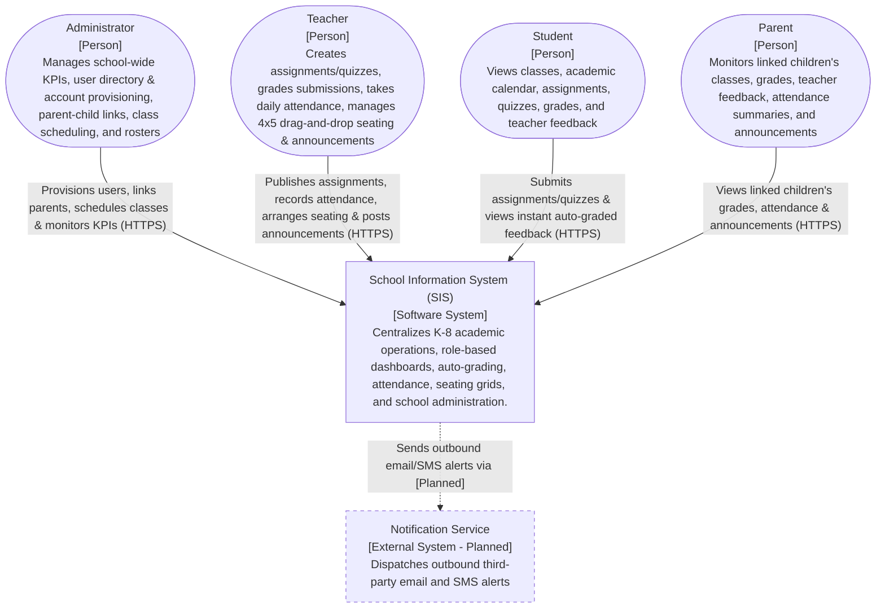
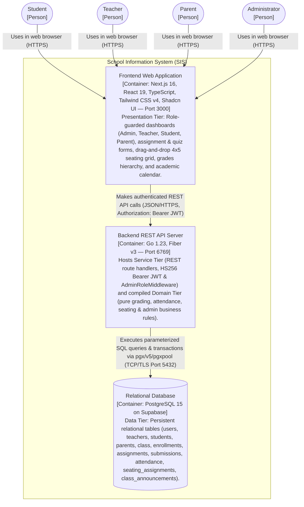
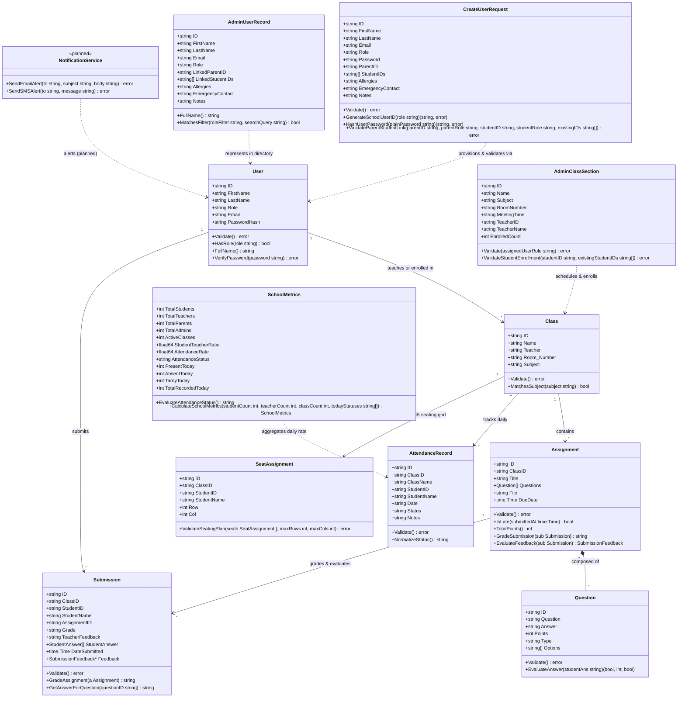
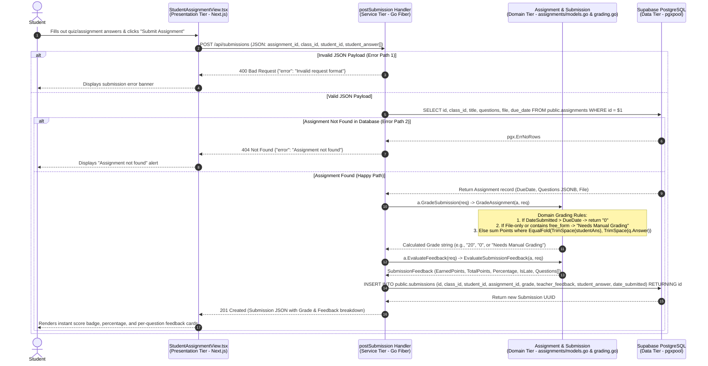

# CEN 5064: SOFTWARE DESIGN (FALL 2026)
## SOFTWARE DESIGN DOCUMENT (SDD) — FINAL AS-BUILT DELIVERABLE
### K-8 SCHOOL INFORMATION SYSTEM (SIS)

- **Student:** Joseph Gabrie
- **Partner:** Jesse Trueba
- **Course:** CEN 5064 – Software Design
- **Institution:** Department of Computer Science & Engineering
- **Date:** November 20, 2026

---

## 1. Introduction

### 1.1 Purpose
The **K-8 School Information System (SIS)** is a full-stack, role-based web application built to centralize daily academic, classroom, and administrative operations for elementary and middle schools. Traditional K-8 schools frequently rely on disconnected spreadsheets, paper attendance sheets, manual quiz grading, and fragmented parent communication channels, which leads to delayed feedback for students, administrative bottlenecks during enrollment, and limited visibility for parents. Our SIS solves this problem by integrating school-wide administration, class roster scheduling, assignment and quiz publishing, deterministic domain auto-grading, daily attendance tracking, interactive drag-and-drop classroom seating charts, class announcements, and parent progress monitoring into a unified, strictly layered 4-tier software system backed by Next.js, Go (Fiber), and Supabase PostgreSQL.

### 1.2 Users
The system serves four distinct authenticated user roles enforced through server-side HMAC-SHA256 (HS256) JSON Web Token (JWT) middleware (`backend/auth/middleware.go`, `backend/admin/handlers.go`) and client-side route guards (`frontend/components/auth-guard.tsx`, `frontend/components/role-guard.tsx`):
- **Students (`role: "student"`):** Sign in with their 6-digit school User ID or email address to view their enrolled classes on `StudentDashboard.tsx`, check upcoming named assignments on the academic calendar (`frontend/app/calendar/page.tsx`), complete multi-question quizzes and assignments (`StudentAssignmentView.tsx`), and receive instant auto-graded scores, per-question feedback breakdowns, and written teacher review comments (`frontend/app/class/[classId]/grades/page.tsx`).
- **Teachers (`role: "teacher"`):** Sign in with their 8-digit staff ID or email address to manage assigned class sections on `TeacherDashboard.tsx`, author named assignments and multi-question quizzes (`CreateAssignmentForm.tsx`), extend due dates, review student submissions and enter manual grades or optional written feedback (`PUT /api/submissions/:id/grade`), record daily attendance (`present`, `absent`, `tardy`), arrange students on an interactive 4×5 HTML5 drag-and-drop classroom seating grid (`ClassroomAttendanceManager.tsx`), and publish class announcements.
- **Parents (`role: "parent"`):** Sign in to the dedicated Parent Portal (`ParentDashboard.tsx`) to monitor all children linked to their account (`public.students.parent_id`), viewing each child's enrolled class schedule, assignment grades, teacher review feedback, attendance rate summaries (`AttendanceSummary`), chronological attendance logs, and teacher announcements in a single aggregated view (`GET /api/parents/:parentId/overview`).
- **Administrators (`role: "admin"`):** Sign in to the institutional Admin Dashboard (`AdminDashboard.tsx`) protected by `AdminRoleMiddleware()` to monitor real-time school-wide KPIs (`SchoolMetrics`, student-to-teacher ratio, and daily campus attendance health classification), search and filter the school user directory, provision new Student, Teacher, Parent, and Admin accounts with automatic role-based ID generation (`GenerateSchoolUserID`) and immediate family/medical metadata attachment (`allergies`, `emergency_contact`, `notes`, parent/child links), schedule class sections with room numbers and meeting times, and manage student class rosters.

### 1.3 Core Use Cases

1. **Assignment & Quiz Publishing, Submission, and Instant Domain Auto-Grading:** A teacher navigates to `/teacher/assignments/create` (`CreateAssignmentForm.tsx`) to publish an assignment or multi-question quiz containing objective questions (`multiple_choice`, `true_false`, `fill_in_the_blank`) and/or subjective prompts (`free_form`) with a title, point values, and a due date (`POST /api/assignments`). When an enrolled student opens the assignment in `StudentAssignmentView.tsx` and submits their answers (`POST /api/submissions`), the Service handler (`postSubmission` in `backend/assignments/handlers.go`) loads the target `Assignment` from PostgreSQL and invokes the pure Domain methods `Assignment.GradeSubmission(req)` (`GradeAssignment`) and `Assignment.EvaluateFeedback(req)` (`EvaluateSubmissionFeedback`). The Domain tier automatically assigns a score of `"0"` if `submission.DateSubmitted` is after `assignment.DueDate` (`IsLate`), scores objective questions case-insensitively, flags `free_form` or file-based submissions as `"Needs Manual Grading"`, and returns a structured `SubmissionFeedback` breakdown that is persisted to `public.submissions` and displayed immediately to the student. Teachers can subsequently drill down by student on the hierarchical **Grades & Feedback** page (`frontend/app/class/[classId]/grades/page.tsx`) to override grades and save written review comments (`teacher_feedback` via `PUT /api/submissions/:id/grade`).

2. **Admin School-Wide KPI Monitoring, User Provisioning, and Class & Roster Scheduling:** An administrator logs into `AdminDashboard.tsx`, which queries `GET /api/admin/metrics` to compute real-time headcounts across all four roles, active class counts, the campus student-to-teacher ratio, and today's attendance percentage classified by the pure domain method `SchoolMetrics.EvaluateAttendanceStatus()` into `"Healthy"` ($\ge 90\%$), `"Moderate"` ($\ge 75\%$), `"Needs Attention"` ($< 75\%$), or `"No Records Today"`. From the User Management Directory (`GET` & `POST /api/admin/users`), the administrator creates new accounts validated by `CreateUserRequest.Validate()`, generates cryptographically random 6-digit student IDs or 8-digit staff/parent IDs via `GenerateSchoolUserID()`, hashes passwords with `bcrypt` via `HashUserPassword()`, and attaches parent accounts, child accounts, allergies, emergency contacts, and notes in a single workflow (`ValidateParentStudentLink`). From the Class Schedule tab (`POST /api/admin/classes` and `POST /api/admin/classes/:classId/enroll`), the administrator creates class sections with `class_name`, `subject`, `room_number`, `meeting_time`, and a searchable teacher assignment validated by `AdminClassSection.Validate()`, and enrolls students into rosters validated against duplicate enrollments by `ValidateStudentEnrollment()`.

3. **Classroom Attendance Tracking & Interactive Drag-and-Drop 4×5 Seating Grid:** A teacher opens a class section's **Attendance & Seating** view (`frontend/app/class/[classId]/attendance/page.tsx`, rendering `ClassroomAttendanceManager.tsx`), which is restricted via `RoleGuard` and navigation filtering so that only teachers, parents, and administrators can view attendance records. In the interactive 4×5 classroom seating grid, the teacher drags students from the unassigned class roster pool onto desk coordinates `(row, col)`, swaps students between desks, or drags students back to the unassigned pool. Saving the layout (`PUT /api/classes/:classId/seating`) invokes the pure domain rule `ValidateSeatingPlan(seats, maxRows, maxCols)` in `backend/attendance/service.go` to verify grid bounds and ensure no two students occupy the same coordinate and no student is assigned to multiple desks. On the daily attendance tab (`POST /api/classes/:classId/attendance`), the teacher marks each student as `present`, `absent`, or `tardy` with optional notes; each record is validated and normalized by `AttendanceRecord.Validate()` and `AttendanceRecord.NormalizeStatus()`, persisted via an atomic PostgreSQL upsert (`ON CONFLICT (class_id, student_id, date) DO UPDATE`), and grouped into historical daily logs by `GroupAttendanceByDate()`.

4. **Parent Portal Multi-Child Academic & Attendance Aggregation and Class Announcements:** Teachers and administrators post class-level announcements (`POST /api/classes/:classId/announcements`) that appear on the Class Overview and Announcements pages (`frontend/app/class/[classId]/announcements/page.tsx`). When a parent logs into `ParentDashboard.tsx`, the frontend requests `GET /api/parents/:parentId/overview` (`getParentOverview` in `backend/attendance/handlers.go`), which queries all students linked to that parent (`WHERE s.parent_id = $1`) and aggregates each child's enrolled classes, assignments, auto-graded or teacher-reviewed submissions (including per-question `SubmissionFeedback` and `teacher_feedback`), class announcements, and attendance percentage computed via the domain function `CalculateAttendanceSummary(records)`.

### 1.4 Scope

#### What Is In-Scope (Implemented, Tested & End-to-End Connected)
- **Multi-Role Authentication & Stateless JWT RBAC:** Credential sign-in (`POST /api/login/`) via numeric School ID or email address verified against `bcrypt` hashes (`User.VerifyPassword`), signed HS256 JWT issuance, server-side authorization middleware (`RequiredLogin`, `RequiredRoles`, `AdminRoleMiddleware`), and frontend route guards (`AuthGuard`, `RoleGuard`).
- **Admin Dashboard & Institutional Management (`/api/admin/*`):** School-wide KPI calculation (`CalculateSchoolMetrics`, `EvaluateAttendanceStatus`), searchable user directory (`FilterUsers`, `MatchesFilter`), user account creation with cryptographic ID generation (`GenerateSchoolUserID`) and student medical/family metadata (`allergies`, `emergency_contact`, `notes`, parent/child links), parent-student linking (`ValidateParentStudentLink`), class section scheduling with `meeting_time` and room format validation (`AdminClassSection.Validate`), and roster enrollment management (`ValidateStudentEnrollment`).
- **Assignment & Quiz Engine with Instant Auto-Grading & Teacher Review (`/api/assignments/*`, `/api/submissions/*`):** Named assignment and quiz creation (`CreateAssignmentForm.tsx`), due-date extension modals (`PUT /api/assignments/:id/due-date`), pure domain auto-grading (`GradeAssignment`, `EvaluateSubmissionFeedback`) with late-submission zeroing (`Assignment.IsLate`), student submission view (`StudentAssignmentView.tsx`), and hierarchical student **Grades & Feedback** view (`grades/page.tsx`) with manual grade overrides and written teacher feedback (`PUT /api/submissions/:id/grade`).
- **Daily Attendance & Interactive 4×5 Drag-and-Drop Seating Chart (`/api/classes/:classId/attendance`, `/api/classes/:classId/seating`):** Role-restricted attendance recording (`present`, `absent`, `tardy`), historical attendance log grouping (`GroupAttendanceByDate`), student attendance rate calculation (`CalculateAttendanceSummary`), and HTML5 drag-and-drop seating chart management with domain collision detection (`ValidateSeatingPlan`).
- **Class Announcements, Academic Calendar & Parent Portal (`/api/classes/:classId/announcements`, `/api/parents/:parentId/overview`):** Class announcement publishing, unified academic calendar displaying named assignment due dates (`calendar/page.tsx`), and the multi-child Parent Portal dashboard (`ParentDashboard.tsx`).

#### What Is Out-of-Scope
- **External Third-Party Email/SMS Gateways (`NotificationService`):** All academic announcements, grade feedback, and calendar deadlines are delivered as in-app notifications and portal views. Outbound third-party SMTP/SMS delivery (`NotificationService`) is out of scope for the core release and is explicitly marked `<<planned>>` with a dashed border in our C4 Context and UML Class diagrams.
- **External AI Essay Plagiarism Detection:** As documented in ADR-003, external AI plagiarism detection was formally dropped from scope and replaced with the **Admin Dashboard & School Management Subsystem**; subjective `free_form` and file-based submissions are instead flagged by `GradeAssignment()` as `"Needs Manual Grading"` for teacher review and written feedback.
- **Tuition Billing, Payroll & Bus Routing:** Financial accounting and transportation logistics are outside the academic scope of this K-8 SIS.

#### What Changed Since the Midterm
1. **Connected All Assignment, Attendance, Announcement & Admin Workflows End-to-End:** At the midterm deadline, `CreateAssignmentForm.tsx` only logged form data to the console and assignment routes were merged after the cutoff in PR #18. Since the midterm, we connected `CreateAssignmentForm.tsx`, `StudentAssignmentView.tsx`, `ClassroomAttendanceManager.tsx`, `ParentDashboard.tsx`, `AdminDashboard.tsx`, and all class subpages (`/class/[classId]/assignments`, `/quizzes`, `/grades`, `/attendance`, `/announcements`) to live Go Fiber REST endpoints and PostgreSQL persistence.
2. **Replaced Planned AI Plagiarism Detection with the Full Admin Dashboard (ADR-003):** Instead of relying on an external AI detection API, we implemented the complete `backend/admin/` package and `AdminDashboard.tsx` so administrators can monitor campus KPIs, provision users with medical/family links, schedule classes with `meeting_time`, and manage student enrollments.
3. **Refactored All Business Rules into Pure Domain Structs & Eliminated Unimplemented Table Claims:** We removed speculative midterm tier-table claims (grade scales, overlapping classes, prerequisites) and refactored all real validations and calculations into pure, unit-tested Domain methods across `backend/assignments/`, `backend/admin/`, `backend/attendance/`, `backend/auth/`, and `backend/api/`.
4. **Hardened Security, Database Error Handling & Repository Hygiene (ADR-004):** We enforced signed HS256 Bearer JWT verification in `AdminRoleMiddleware()` (eliminating client `X-User-Role` header spoofing), removed hardcoded fallback IDs from `GenerateSchoolUserID()`, added `rows.Err()` checks after every `rows.Next()` loop across the backend, removed plaintext login passwords and compiled binaries from the repository, and documented complete Supabase database setup instructions.

---

## 2. N-Tier Architecture

### 2.1 Tier Table

| Tier | What It Does in Our System | Real Folders, Files & Classes/Structs in Our Repository |
|---|---|---|
| **Presentation** | Renders role-based user interfaces and handles client-side interactions for students, teachers, parents, and administrators. Manages client-side routing, form validation state (React Hook Form + Zod), and authentication state (`AuthContext`). Displays role-specific dashboards (`AdminDashboard`, `TeacherDashboard`, `StudentDashboard`, `ParentDashboard`), class schedules, assignment creation forms, interactive quiz-taking views, instant auto-grading feedback cards, hierarchical student grade views with teacher review feedback, class announcements, the academic calendar, and the HTML5 drag-and-drop 4×5 seating and attendance grid. | **Folders:** `frontend/app/`, `frontend/components/`, `frontend/contexts/`, `frontend/hooks/`, `frontend/lib/`<br>**Pages:** `frontend/app/page.tsx`, `frontend/app/layout.tsx`, `frontend/app/profile/page.tsx`, `frontend/app/calendar/page.tsx`, `frontend/app/teacher/assignments/create/page.tsx`, `frontend/app/class/[classId]/page.tsx`, `frontend/app/class/[classId]/assignments/page.tsx`, `frontend/app/class/[classId]/quizzes/page.tsx`, `frontend/app/class/[classId]/grades/page.tsx`, `frontend/app/class/[classId]/attendance/page.tsx`, `frontend/app/class/[classId]/announcements/page.tsx`<br>**Components & Contexts:** `frontend/components/dashboards/AdminDashboard.tsx`, `TeacherDashboard.tsx`, `StudentDashboard.tsx`, `ParentDashboard.tsx`; `frontend/components/assignments/CreateAssignmentForm.tsx`, `StudentAssignmentView.tsx`; `frontend/components/attendance/ClassroomAttendanceManager.tsx`; `frontend/components/auth-guard.tsx` (`AuthGuard`), `frontend/components/role-guard.tsx` (`RoleGuard`), `frontend/components/sign-in-page.tsx` (`SignInPage`), `frontend/components/app-sidebar.tsx` (`AppSidebar`), `frontend/components/class-card.tsx` (`ClassCard`), `frontend/contexts/AuthContext.tsx` (`AuthProvider`, `useAuth`) |
| **Service** | Orchestrates application workflows, processes incoming HTTP REST requests via Go Fiber v3, enforces stateless signed HS256 Bearer JWT authentication and role-based access control (`AdminRoleMiddleware`, `RequiredLogin`, `RequiredRoles`), and coordinates pure Domain business rules with Data tier persistence. Exposes REST endpoints for user login, school-wide admin KPIs and user/class provisioning, class rosters, assignment publishing/editing, submission auto-grading and teacher grade overrides, daily attendance recording, seating chart persistence, class announcements, and parent multi-child overview aggregation. | **Folders & Files:** `backend/main/main.go` (`main()`, route registration, CORS), `backend/auth/signIn.go` (`SetupAuthRoutes`, `POST /api/login/`, HS256 JWT generation), `backend/auth/middleware.go` (`RequiredLogin()`, `RequiredRoles()`), `backend/admin/handlers.go` (`SetupAdminRoutes`, `AdminRoleMiddleware()`, `getSchoolMetrics`, `getTeachers`, `getStudents`, `getAdminClasses`, `postAdminClass`, `postEnrollStudent`, `deleteEnrollStudent`, `getAdminUsers`, `postAdminUser`, `postParentStudentLink`), `backend/api/handler.go` (`GetUserClassess`), `backend/assignments/handlers.go` (`SetupAssignmentRoutes`, `DueDateUpdateRequest`, `GradeUpdateRequest`, `postAssignment`, `getAssignment`, `putAssignment`, `putDueDate`, `postSubmission`, `getSubmission`, `putSubmissionGrade`, `getClassAssignments`, `getClassSubmissions`, `getUserAssignments`, `getUserSubmissions`), `backend/attendance/handlers.go` (`SetupAttendanceAndPortalRoutes`, `getClassRoster`, `getClassAttendance`, `saveClassAttendance`, `getUserAttendance`, `getClassSeating`, `saveClassSeating`, `getClassAnnouncements`, `createClassAnnouncement`, `getParentOverview`) |
| **Domain** | Encapsulates core K-8 school business rules, domain entities, validation invariants, grading algorithms, attendance rate calculations, seating collision detection, and administrative KPI/provisioning rules completely independent of HTTP transport (`fiber.Ctx`) or database drivers (`pgxpool`). Every domain rule is implemented as a pure method or function on domain structs and verified by deterministic unit tests without network or database mocks. | **Assignments Domain (`backend/assignments/models.go`, `grading.go`, `grading_test.go`):** `Assignment`, `Question`, `Submission`, `StudentAnswer`, `SubmissionFeedback`, `QuestionFeedback` structs; methods `Assignment.Validate()`, `Assignment.IsLate()`, `Assignment.TotalPoints()`, `Assignment.GradeSubmission()`, `Assignment.EvaluateFeedback()`, `Question.Validate()`, `Question.EvaluateAnswer()`, `Submission.Validate()`, `Submission.GradeAssignment()`, `Submission.GetAnswerForQuestion()`, `GradeAssignment()`, `EvaluateSubmissionFeedback()`<br>**Admin Domain (`backend/admin/models.go`, `admin_test.go`):** `SchoolMetrics`, `AdminClassSection`, `AdminUserRecord`, `CreateUserRequest`, `TeacherOption`, `EnrollStudentRequest`, `ParentStudentLinkRequest` structs; methods `SchoolMetrics.EvaluateAttendanceStatus()`, `CalculateSchoolMetrics()`, `AdminClassSection.Validate()`, `ValidateStudentEnrollment()`, `AdminUserRecord.FullName()`, `AdminUserRecord.MatchesFilter()`, `FilterUsers()`, `CreateUserRequest.Validate()`, `ValidateParentStudentLink()`, `GenerateSchoolUserID()`, `HashUserPassword()`<br>**Attendance & Seating Domain (`backend/attendance/models.go`, `service.go`, `attendance_test.go`):** `AttendanceRecord`, `SeatAssignment`, `AttendanceSummary`, `DailyAttendanceLog`, `BatchAttendanceRequest`, `SeatingPlanRequest`, `Announcement`, `LinkedChildOverview`, `ParentOverviewResponse` structs; methods `AttendanceRecord.Validate()`, `AttendanceRecord.NormalizeStatus()`, `NormalizeAttendanceStatus()`, `ValidateAttendanceStatus()`, `CalculateAttendanceSummary()`, `ValidateSeatingPlan()`, `GroupAttendanceByDate()`<br>**Auth & Class Domain (`backend/auth/models.go`, `auth_test.go`, `backend/api/handler.go`, `class_test.go`):** `User` (`Validate()`, `HasRole()`, `FullName()`, `VerifyPassword()`) and `Class` (`Validate()`, `MatchesSubject()`) |
| **Data** | Manages persistent relational data storage, database connection pooling (`*pgxpool.Pool`), SQL schema creation, foreign-key and uniqueness constraints, and parameterized SQL query execution (with mandatory `rows.Err()` post-iteration verification) across all 11 relational tables (`public.users`, `public.teachers`, `public.students`, `public.parents`, `public.class`, `public.enrollments`, `public.assignments`, `public.submissions`, `public.attendance`, `public.seating_assignments`, `public.class_announcements`). Connects to hosted PostgreSQL 15+ on Supabase. | **Database & Schema Files:** Supabase Cloud PostgreSQL 15+, `backend/main/main.go` (`connect()` initializing `*pgxpool.Pool` via `SUPABASE_CONNECTION_STRING`), `backend/init_schema.sql` (complete 11-table master DDL schema), `backend/init_assignments.sql`, `backend/init_attendance.sql`, `backend/main/scripts/generateUser.go` (CLI user seed utility reading `backend/users.json` based on `backend/users.example.json`), parameterized SQL statements executed via `conn.Query`, `conn.QueryRow`, and `conn.Exec` inside `backend/admin/handlers.go`, `backend/assignments/handlers.go`, `backend/attendance/handlers.go`, `backend/api/handler.go`, and `backend/auth/signIn.go` |

### 2.2 Dependency Rule
Our architecture strictly enforces the one-way N-tier dependency rule: **Presentation calls Service, and Service calls Domain and Data; never the other way around.**
1. **Presentation → Service:** Next.js components in `frontend/app/` and `frontend/components/` never import backend packages, never connect directly to Supabase PostgreSQL, and never compute authoritative grades or role authorizations. Instead, the Presentation tier sends JSON HTTP requests (including the signed `Authorization: Bearer <token>` JWT header) to the Go Fiber REST API endpoints exposed on port `6769`.
2. **Service → Domain and Data:** The Go Fiber handlers in `backend/assignments/handlers.go`, `backend/admin/handlers.go`, `backend/attendance/handlers.go`, `backend/auth/signIn.go`, and `backend/api/handler.go` act as thin coordinators. Each handler parses the HTTP request body (`c.Bind().Body(&req)`), loads any prerequisite rows from the Data tier via `*pgxpool.Pool`, delegates all business validation and calculation to pure Domain structs and methods (such as `req.Validate()`, `a.GradeSubmission(req)`, `a.EvaluateFeedback(req)`, `CalculateSchoolMetrics(...)`, `ValidateSeatingPlan(...)`), and persists the resulting domain state back to PostgreSQL.
3. **Zero Reverse Dependencies (`Domain ↛ Service/Data/Presentation`):** None of our Domain files (`backend/assignments/models.go`, `backend/assignments/grading.go`, `backend/admin/models.go`, `backend/attendance/models.go`, `backend/attendance/service.go`, `backend/auth/models.go`) import `github.com/gofiber/fiber/v3` or `github.com/jackc/pgx/v5/pgxpool`. The Domain tier has zero knowledge of HTTP status codes, headers, or SQL connections, and the Data tier (PostgreSQL tables and `pgxpool`) never invokes Service or Presentation logic.

### 2.3 Where Our Business Rules Live
Every business rule in our system resides in the **Domain Tier** and is verified by dedicated Go unit tests:

- **Assignment & Quiz Validation (`backend/assignments/models.go`):**
  - `Assignment.Validate() error` enforces that every assignment has a non-empty `ClassID`, a non-zero `DueDate`, and that every child `Question` passes `Question.Validate()`.
  - `Question.Validate() error` enforces that `Question` text is non-empty, `Points >= 0`, `Type` belongs to the allowed set `{"multiple_choice", "free_form", "fill_in_the_blank", "true_false"}`, and any `"multiple_choice"` question provides at least 2 answer options (`len(q.Options) >= 2`).
  - `Submission.Validate() error` enforces that every student submission specifies a non-empty `StudentID` and `AssignmentID`.
- **Late-Submission Penalty, Auto-Grading & Per-Question Feedback (`backend/assignments/models.go` & `backend/assignments/grading.go`):**
  - `Assignment.IsLate(submittedAt time.Time) bool` checks whether `submittedAt.After(a.DueDate)`.
  - `Assignment.GradeSubmission(sub Submission) string` (delegating to `GradeAssignment(assignment, submission)`) and `Submission.GradeAssignment(a Assignment) string` enforce our core grading policy: (1) if `submission.DateSubmitted.After(assignment.DueDate)`, the student automatically receives `"0"`; (2) if the assignment is file-based (`len(assignment.Questions) == 0 && assignment.File != ""`) or contains any `"free_form"` question, it returns `"Needs Manual Grading"`; (3) otherwise, it sums `q.Points` for every objective question where `strings.EqualFold(strings.TrimSpace(studentAns), strings.TrimSpace(q.Answer))`.
  - `Assignment.EvaluateFeedback(sub Submission) SubmissionFeedback` (delegating to `EvaluateSubmissionFeedback(assignment, submission)`) and `Question.EvaluateAnswer(studentAns string)` generate a question-by-question breakdown (`IsCorrect`, `NeedsReview`, `AwardedPoints`, `MaxPoints`), zero out `EarnedPoints` when `IsLate` is true, and calculate the overall percentage rounded to one decimal place with a zero-division guard (`if totalPoints > 0`).
- **User Identity, Role & Password Verification (`backend/auth/models.go`):**
  - `User.Validate() error` checks that `ID` is non-empty, `Role` is one of `"student"`, `"teacher"`, `"admin"`, or `"parent"`, and any non-empty `Email` contains `"@"`.
  - `User.HasRole(role string) bool` performs case-insensitive role matching, `User.FullName() string` formats the user's display name (falling back to `ID` if names are blank), and `User.VerifyPassword(password string) error` rejects empty passwords and verifies plaintext input against `User.PasswordHash` using `bcrypt.CompareHashAndPassword`.
- **Class Validation & Subject Matching (`backend/api/handler.go`):**
  - `Class.Validate() error` ensures `Name` and `Subject` are non-empty, and `Class.MatchesSubject(subject string) bool` compares class subjects case-insensitively.
- **Attendance Validation, Rate Calculation & Seating Grid Collision Rules (`backend/attendance/models.go` & `backend/attendance/service.go`):**
  - `AttendanceRecord.Validate() error` and `AttendanceRecord.NormalizeStatus() string` (along with `NormalizeAttendanceStatus` and `ValidateAttendanceStatus`) verify that `StudentID` and `Date` are non-empty and that `Status` normalizes to `"present"`, `"absent"`, or `"tardy"`.
  - `CalculateAttendanceSummary(records []AttendanceRecord) AttendanceSummary` tallies `PresentCount`, `TardyCount`, and `AbsentCount`, and computes `AttendanceRate = Round(((PresentCount + TardyCount) / TotalDays) * 1000) / 10` with an empty-slice guard.
  - `GroupAttendanceByDate(records []AttendanceRecord) []DailyAttendanceLog` groups chronological records into per-day logs with daily present/absent/tardy tallies.
  - `ValidateSeatingPlan(seats []SeatAssignment, maxRows, maxCols int) error` enforces three classroom seating invariants on the `SeatAssignment` domain struct: (1) every seat must have a non-empty `StudentID` and lie within `0 <= Row < maxRows` and `0 <= Col < maxCols`; (2) no two students can occupy the same `"row:col"` coordinate (`occupiedCoords`); and (3) no single student can be assigned to multiple seats simultaneously (`assignedStudents`).
- **Admin School-Wide KPIs, Class Scheduling, Roster Enrollment & User Provisioning (`backend/admin/models.go`):**
  - `CalculateSchoolMetrics(studentCount, teacherCount, classCount int, todayStatuses []string) SchoolMetrics` and `SchoolMetrics.EvaluateAttendanceStatus() string` clamp negative inputs to zero, compute `StudentTeacherRatio` with a `teacherCount > 0` zero-division guard, calculate today's campus-wide attendance rate from normalized attendance statuses, and classify campus health into `"No Records Today"`, `"Healthy"` ($\ge 90.0\%$), `"Moderate"` ($\ge 75.0\%$), or `"Needs Attention"` ($< 75.0\%$).
  - `AdminClassSection.Validate(assignedUserRole string) error` enforces non-empty class name and subject, validates `RoomNumber` against the alphanumeric regular expression `^[A-Za-z0-9][A-Za-z0-9\s\-]{0,19}$`, requires an assigned `TeacherID`, and verifies that the assigned user's role is `"teacher"`.
  - `ValidateStudentEnrollment(studentID string, existingStudentIDs []string) error` rejects empty student IDs and prevents duplicate enrollments (`ErrDuplicateEnrollment`) when a student is already on the class roster.
  - `AdminUserRecord.MatchesFilter(roleFilter, searchQuery string) bool` and `FilterUsers(...)` filter user directory records by role and substring match across full name, email, or school ID.
  - `CreateUserRequest.Validate() error` requires non-empty first/last names, non-empty email, password length $\ge 6$ (`ErrWeakPassword`), and delegates to `auth.User.Validate()`.
  - `GenerateSchoolUserID(role string) (string, error)` uses `crypto/rand.Int` to generate a cryptographically random 6-digit ID (`100000–999999`) for `"student"` accounts or an 8-digit ID (`10000000–99999999`) for `"teacher"`, `"parent"`, and `"admin"` accounts, returning an explicit error if CSPRNG fails rather than falling back to a hardcoded ID.
  - `HashUserPassword(plainPassword string) (string, error)` enforces the minimum 6-character password rule before generating a `bcrypt.DefaultCost` hash.
  - `ValidateParentStudentLink(parentID, parentRole, studentID, studentRole string, existingLinkedStudentIDs []string) error` verifies that both IDs are provided, the parent holds role `"parent"`, the child holds role `"student"`, and the child is not already linked to that parent (`ErrDuplicateParentStudentLink`).

### 2.4 SOLID Principles & Design Pattern Mapping

#### Applied SOLID Principles (With Exact File & Class/Struct Locations)

| SOLID Principle | How It Is Applied in Our Codebase | Exact File, Struct/Component & Function Locations |
|---|---|---|
| **S — Single Responsibility Principle (SRP)** | Each file within a feature package has a single, well-defined reason to change. In `backend/assignments/`, domain structs and validation invariants reside in `models.go`, pure auto-grading and feedback scoring algorithms reside in `grading.go`, and Fiber HTTP request binding and SQL execution reside in `handlers.go`. In `backend/attendance/`, domain entities and record validation reside in `models.go`, pure attendance summary aggregation and seating collision validation reside in `service.go`, and HTTP route handlers reside in `handlers.go`. On the frontend, authentication state management is isolated in `AuthContext.tsx`, route protection in `auth-guard.tsx` and `role-guard.tsx`, and role-specific views in separate dashboard components. | `backend/assignments/models.go` (`Assignment.Validate`, `Question.Validate`, `Submission.Validate`), `backend/assignments/grading.go` (`GradeAssignment`, `EvaluateSubmissionFeedback`), `backend/assignments/handlers.go` (`postAssignment`, `postSubmission`), `backend/attendance/models.go` (`AttendanceRecord.Validate`), `backend/attendance/service.go` (`CalculateAttendanceSummary`, `ValidateSeatingPlan`, `GroupAttendanceByDate`), `backend/attendance/handlers.go` |
| **O — Open/Closed Principle (OCP)** | Authorization middleware and question validation/scoring are open for extension without modifying underlying callers. `RequiredRoles(allowedRoles ...string)` in `backend/auth/middleware.go` and `<RoleGuard allowedRoles={[...]}>` in `frontend/components/role-guard.tsx` accept arbitrary role combinations to protect new routes without modifying the JWT parser or guard logic. Similarly, `Question.Validate()` in `backend/assignments/models.go` validates against a declarative `validTypes` map (`multiple_choice`, `free_form`, `fill_in_the_blank`, `true_false`) and `Question.EvaluateAnswer()` encapsulates per-question evaluation so new question types can be introduced without altering `Submission` persistence. | `backend/auth/middleware.go` (`RequiredRoles(allowedRoles ...string)`), `frontend/components/role-guard.tsx` (`RoleGuard`), `backend/assignments/models.go` (`Question.Validate`, `Question.EvaluateAnswer`) |
| **L — Liskov Substitution Principle (LSP)** | Every Service-tier route factory and middleware conforms to Fiber's `fiber.Handler` (`func(fiber.Ctx) error`) contract, and every domain entity implements a uniform `Validate() error` method contract (`User.Validate()`, `Class.Validate()`, `Assignment.Validate()`, `Question.Validate()`, `Submission.Validate()`, `AttendanceRecord.Validate()`, `CreateUserRequest.Validate()`). Furthermore, `CreateUserRequest.Validate()` in `backend/admin/models.go` constructs an `auth.User` value and delegates directly to `domainUser.Validate()`, guaranteeing behavioral consistency across user login and admin user creation. | `backend/auth/middleware.go` (`RequiredLogin`, `RequiredRoles`), `backend/admin/handlers.go` (`AdminRoleMiddleware`), `backend/admin/models.go` (`CreateUserRequest.Validate` delegating to `auth.User.Validate`), `backend/assignments/models.go`, `backend/attendance/models.go` |
| **I — Interface Segregation Principle (ISP)** | Neither UI components nor REST endpoints are forced to depend on bloated, all-purpose interfaces or payloads. On the frontend, each school role renders its own dedicated component (`StudentDashboard.tsx`, `TeacherDashboard.tsx`, `ParentDashboard.tsx`, `AdminDashboard.tsx`) consuming only the props and endpoints relevant to that role. On the backend, narrower operations use dedicated request structs (`DueDateUpdateRequest` for `PUT /api/assignments/:id/due-date`, `GradeUpdateRequest` for `PUT /api/submissions/:id/grade`, `EnrollStudentRequest` for `POST /api/admin/classes/:classId/enroll`, `ParentStudentLinkRequest` for `POST /api/admin/parent-links`, `BatchAttendanceRequest` and `SeatingPlanRequest` for attendance and seating updates) rather than requiring full entity payloads. | `frontend/components/dashboards/StudentDashboard.tsx`, `TeacherDashboard.tsx`, `ParentDashboard.tsx`, `AdminDashboard.tsx`; `backend/assignments/handlers.go` (`DueDateUpdateRequest`, `GradeUpdateRequest`), `backend/admin/models.go` (`EnrollStudentRequest`, `ParentStudentLinkRequest`), `backend/attendance/models.go` (`BatchAttendanceRequest`, `SeatingPlanRequest`) |
| **D — Dependency Inversion Principle (DIP)** | High-level Domain business logic does not depend on low-level database (`pgxpool`) or HTTP (`fiber`) modules. Instead, the Service tier extracts primitive slices and domain structs from PostgreSQL rows and passes them into pure Domain functions (`GradeAssignment(a, req)`, `EvaluateSubmissionFeedback(a, req)`, `CalculateSchoolMetrics(studentCount, teacherCount, classCount, statuses)`, `CalculateAttendanceSummary(records)`, `ValidateSeatingPlan(req.Seats, req.MaxRows, req.MaxCols)`). Additionally, HTTP handlers receive `*pgxpool.Pool` via higher-order closure injection (`postSubmission(conn *pgxpool.Pool) fiber.Handler`) rather than global state, allowing unit tests (`backend/assignments/handlers_test.go`, `backend/admin/admin_test.go`) to test handlers in isolation. | `backend/assignments/grading.go` (`GradeAssignment`, `EvaluateSubmissionFeedback`), `backend/admin/models.go` (`CalculateSchoolMetrics`), `backend/attendance/service.go` (`CalculateAttendanceSummary`, `ValidateSeatingPlan`), `backend/assignments/handlers.go` (`SetupAssignmentRoutes(app, conn)`), `backend/admin/handlers.go` (`SetupAdminRoutes(app, conn)`) |

#### Design Pattern Mapping (Including Honest "No Fit" Entries)

| Design Pattern | Fit Status | Where It Lives (File / Class / Function Named) or Honest Architectural Reason for "No Fit" |
|---|---|---|
| **Chain of Responsibility / Middleware Pattern** | **Applied** | **Locations:** `backend/auth/middleware.go` (`RequiredLogin()`, `RequiredRoles(allowedRoles ...string)`), `backend/admin/handlers.go` (`AdminRoleMiddleware()`, `SetupAdminRoutes`), and `backend/main/main.go` (`cors.New()`). Requests pass through a chain of `fiber.Handler` interceptors that verify the `Authorization: Bearer <token>` HS256 JWT signature against `JWT_SECRET`, inject `c.Locals("userID")` and `c.Locals("userRole")`, and either halt execution with `401 Unauthorized` / `403 Forbidden` or forward control via `c.Next()`. |
| **Closure-Based Dependency Injection (Handler Factory Pattern)** | **Applied** | **Locations:** `backend/assignments/handlers.go` (`postAssignment(conn)`, `getAssignment(conn)`, `putAssignment(conn)`, `putDueDate(conn)`, `postSubmission(conn)`, `getSubmission(conn)`, `putSubmissionGrade(conn)`), `backend/admin/handlers.go` (`getSchoolMetrics(conn)`, `getAdminClasses(conn)`, `postAdminClass(conn)`, `postEnrollStudent(conn)`, `getAdminUsers(conn)`, `postAdminUser(conn)`, `postParentStudentLink(conn)`), and `backend/attendance/handlers.go` (`saveClassAttendance(conn)`, `saveClassSeating(conn)`, `getParentOverview(conn)`). Each factory closes over `*pgxpool.Pool` and returns a `fiber.Handler`, eliminating global database variables and enabling isolated handler tests (`handlers_test.go`, `admin_test.go`). |
| **Provider & Guard Decorator Pattern (Frontend)** | **Applied** | **Locations:** `frontend/contexts/AuthContext.tsx` (`AuthProvider`, `useAuth()`), `frontend/components/auth-guard.tsx` (`AuthGuard`), and `frontend/components/role-guard.tsx` (`RoleGuard`). `AuthProvider` exposes authenticated user state and JWT persistence across the React component tree, while `AuthGuard` and `RoleGuard` wrap Next.js pages (`frontend/app/layout.tsx`, `frontend/app/class/[classId]/attendance/page.tsx`, `frontend/app/teacher/assignments/create/page.tsx`) to enforce authentication and role permissions before rendering child views. |
| **Rich Domain Model / Pure Function Pattern** | **Applied** | **Locations:** `backend/assignments/models.go` & `grading.go` (`Assignment`, `Question`, `Submission`), `backend/admin/models.go` (`SchoolMetrics`, `AdminClassSection`, `AdminUserRecord`, `CreateUserRequest`), `backend/attendance/models.go` & `service.go` (`AttendanceRecord`, `SeatAssignment`), and `backend/auth/models.go` (`User`). Domain structs co-locate data fields with pure validation and calculation methods (`Validate()`, `GradeSubmission()`, `EvaluateFeedback()`, `EvaluateAttendanceStatus()`, `VerifyPassword()`). |
| **Repository Pattern / ORM Abstraction (`UserRepository`, `AssignmentRepository`)** | **No Fit (Honest Omission)** | **Why it is a No Fit:** Our Service-tier Fiber handlers execute parameterized SQL directly through `pgxpool.Pool` and pass pure value structs to Domain functions (`GradeAssignment(a, sub)`, `CalculateSchoolMetrics(...)`, `ValidateSeatingPlan(...)`). Because our business rules in the Domain tier operate purely on in-memory Go structs and already run 100% offline in unit tests without database mocks (`grading_test.go`, `admin_test.go`, `attendance_test.go`, `auth_test.go`), introducing 11 Repository interfaces and mock structs over a single PostgreSQL database would add ceremonial boilerplate without improving domain testability. |
| **Abstract Factory / Polymorphic Class Hierarchy for Users or Questions** | **No Fit (Honest Omission)** | **Why it is a No Fit:** Go favors flat value structs and composition over classical inheritance hierarchies. All four school roles (`student`, `teacher`, `parent`, `admin`) share the same `auth.User` identity struct (`backend/auth/models.go`), differing only in role string validation and generated ID length (`6-digit` vs. `8-digit` in `GenerateSchoolUserID(role)`). Likewise, all four question types (`multiple_choice`, `true_false`, `fill_in_the_blank`, `free_form`) serialize into a single PostgreSQL `JSONB` array column on `public.assignments` (`[]Question` in `backend/assignments/models.go`). Forcing an Abstract Factory or polymorphic interface hierarchy onto `User` or `Question` would complicate JSON unmarshaling and SQL row scanning for zero gain. |
| **Observer / Pub-Sub Event Bus** | **No Fit (Honest Omission)** | **Why it is a No Fit:** Outbound third-party email/SMS notifications (`NotificationService`) were intentionally scoped out (`<<planned>>`), and all in-app workflows—instant quiz auto-grading feedback, daily attendance KPI calculation, class announcements, and parent portal overviews—require immediate synchronous read-after-write consistency from PostgreSQL. An asynchronous in-memory Observer or Event Bus would risk losing events on container restart and introduce unnecessary eventual-consistency bugs. |

---

## 3. C4 Diagrams

### 3.1 Context Diagram
The C4 Context Diagram below shows the four human user roles (**Student**, **Teacher**, **Parent**, and **Administrator**), our **School Information System (SIS)** as a single black-box software system, and the planned external **Notification Service**. Teachers create assignments, grade submissions, record daily attendance, arrange the 4×5 drag-and-drop seating chart, and post announcements; Students complete assignments and view instant auto-graded feedback; Parents monitor their linked children's grades, attendance summaries, and announcements; and Administrators manage school-wide KPIs, user provisioning, parent-child links, class scheduling, and student rosters. Outbound third-party email/SMS alerts are shown as a dashed `<<planned>>` external system (`Notification Service`), while all in-app announcements, grades, and calendar events are delivered directly within the SIS.



### 3.2 Container Diagram
The C4 Container Diagram below depicts the three independently running software containers that make up the School Information System along with their exact runtime technologies: the **Frontend Web Application (`Next.js 16, React 19, TypeScript, Tailwind CSS v4, Shadcn UI` on port `3000`)**, the **Backend REST API Server (`Go 1.23, Fiber v3` on port `6769`)**, and the **Relational Database (`PostgreSQL 15 hosted on Supabase`)**. Users interact in their web browsers with the Next.js Frontend Web Application (the **Presentation Tier**), which sends JSON over HTTPS requests authenticated with signed HS256 Bearer JWTs to the Go Fiber Backend REST API Server. Inside the Go Backend container, the **Service Tier** (`handlers.go`, `signIn.go`, `middleware.go`) enforces role-based access control and invokes the compiled **Domain Tier** packages (`models.go`, `grading.go`, `service.go`) before executing parameterized SQL queries via `pgx/v5/pgxpool` against the Supabase PostgreSQL Database (**Data Tier**).



---

## 4. UML Diagrams

### 4.1 Class Diagram
The UML Class Diagram below presents our core Domain classes (`User`, `Class`, `Assignment`, `Question`, `Submission`, `AttendanceRecord`, `SeatAssignment`, `SchoolMetrics`, `AdminClassSection`, `AdminUserRecord`, and `CreateUserRequest`) with their exact attributes and operations from `backend/auth/models.go`, `backend/api/handler.go`, `backend/assignments/models.go`, `backend/assignments/grading.go`, `backend/attendance/models.go`, `backend/attendance/service.go`, and `backend/admin/models.go`. In accordance with the specification, the unbuilt external `NotificationService` is drawn with a dashed border and labeled `<<planned>>`.



### 4.2 Sequence Diagram
The UML Sequence Diagram below traces our primary use case—**Student Assignment Submission & Instant Domain Auto-Grading**—across all four architectural tiers (`StudentAssignmentView.tsx` in **Presentation**, `postSubmission` in **Service**, `Assignment` & `Submission` in **Domain**, and `Supabase PostgreSQL` in **Data**). It explicitly illustrates two error paths (`400 Bad Request` when the JSON payload fails binding/validation, and `404 Not Found` when the target `AssignmentID` does not exist in PostgreSQL) alongside the happy path that computes the domain grade and per-question feedback, inserts the record into `public.submissions`, and returns `201 Created` to the student UI.



---

## 5. Working Slice

### 5.1 How to Run (Identical to `README.md`)

#### Step 1: Configure Supabase PostgreSQL & `.env`
1. Create a PostgreSQL 15+ project at [supabase.com](https://supabase.com) and copy the **Transaction/Session Pooler URI** from **Project Settings → Database → Connection string**.
2. Copy `.env.example` to `.env` in the repository root (never commit `.env` to version control):
   ```bash
   cp .env.example .env
   ```
3. Set the required environment variables in `.env`:
   ```env
   SUPABASE_CONNECTION_STRING=postgresql://postgres.<project-id>:<db-password>@aws-0-<region>.pooler.supabase.com:5432/postgres
   JWT_SECRET=your_strong_jwt_signing_secret
   ```

#### Step 2: Initialize the Database Schema
Execute the master schema script [`backend/init_schema.sql`](../backend/init_schema.sql) in the **Supabase SQL Editor** (or via `psql "$SUPABASE_CONNECTION_STRING" -f backend/init_schema.sql`). This script creates all 11 relational tables (`public.users`, `public.teachers`, `public.students`, `public.parents`, `public.class`, `public.enrollments`, `public.assignments`, `public.submissions`, `public.attendance`, `public.seating_assignments`, and `public.class_announcements`) with foreign keys and uniqueness constraints.

#### Step 3: Seed Initial Test Users (Without Committed Passwords)
1. Copy the template [`backend/users.example.json`](../backend/users.example.json) to `backend/users.json` (which is gitignored) and populate your test user entries:
   ```bash
   cp backend/users.example.json backend/users.json
   ```
2. Run the user generator script:
   ```bash
   cd backend/main/scripts
   go run generateUser.go
   ```
   `generateUser.go` calls `crypto/rand` to generate a 6-digit ID for students or an 8-digit ID for teachers/parents/admins, derives the initial password from `MMDDYY` + uppercase initials (`<FirstInitial><LastInitial>`), hashes the password with `bcrypt`, and inserts the records into `public.users`, `public.students`, and `public.teachers`. Once logged in as an Administrator, additional accounts can be created directly in the **Admin Dashboard → User Management Directory**.

#### Step 4: Start the Application (Docker or Local Native)
- **Option A — Run with Docker Compose (Recommended):**
  ```bash
  docker compose up --build
  ```
  - **Frontend Web UI:** `http://localhost:3000`
  - **Backend Fiber REST API:** `http://localhost:6769`
- **Option B — Run Locally Without Docker:**
  ```bash
  # Terminal 1: Start Go Fiber Backend (Port 6769)
  cd backend
  go run ./main/main.go

  # Terminal 2: Start Next.js Frontend (Port 3000)
  cd frontend
  npm install
  npm run dev
  ```

### 5.2 Step-by-Step Walkthrough & Screenshots of the Use Case Working

The steps below demonstrate our end-to-end working vertical slice across all four roles and tiers. *(Insert or verify the corresponding screenshots under each step header in the Word submission if updating visual captures.)*

1. **Step 1 — Role-Based Authentication & JWT Issuance (`SignInPage` → `POST /api/login/`):**
   - The user enters their School User ID (or email) and password on `http://localhost:3000` (`frontend/components/sign-in-page.tsx`).
   - `POST /api/login/` (`backend/auth/signIn.go`) queries `public.users`, verifies the password hash via the domain method `User.VerifyPassword(req.Password)`, and returns a signed HS256 JWT token along with the user's `id`, `role`, `firstName`, `lastName`, and `email`.
   - *[Screenshot 1: Sign-In Page and Authenticated Dashboard Redirect]*

2. **Step 2 — Administrator Dashboard: School-Wide KPIs, User Provisioning & Class Scheduling (`AdminDashboard.tsx` → `/api/admin/*`):**
   - Logging in as an Administrator opens `AdminDashboard.tsx`, which sends `Authorization: Bearer <token>` to `GET /api/admin/metrics`, `GET /api/admin/classes`, and `GET /api/admin/users`.
   - The overview displays total students, teachers, parents, admins, active classes, the student-to-teacher ratio, and today's attendance health badge (`"Healthy"`, `"Moderate"`, `"Needs Attention"`, or `"No Records Today"`) computed by `CalculateSchoolMetrics()` and `SchoolMetrics.EvaluateAttendanceStatus()`.
   - Using the **Create New User Account** modal (`POST /api/admin/users`) and **Schedule New Class Section** modal (`POST /api/admin/classes`), the administrator provisions users (with immediate parent/child links and medical notes) and schedules class sections (with `meeting_time`, `room_number`, teacher search, and roster enrollment).
   - *[Screenshot 2: Admin Dashboard School-Wide KPI Overview, User Directory & Class Scheduling Modals]*

3. **Step 3 — Teacher Publishes a Named Assignment / Multi-Question Quiz (`CreateAssignmentForm.tsx` → `POST /api/assignments`):**
   - Logging in as a Teacher and opening a class (`/class/[classId]/assignments` or `/teacher/assignments/create`) renders `CreateAssignmentForm.tsx`.
   - The teacher enters an **Assignment Name** (`title`), selects a **Due Date**, and adds objective (`multiple_choice`, `true_false`, `fill_in_the_blank`) or subjective (`free_form`) questions with point values.
   - Clicking **Publish Assignment** sends `POST /api/assignments`, which invokes `Assignment.Validate()` and `Question.Validate()` in the Domain tier and persists the assignment to `public.assignments`. The named assignment immediately appears in the class assignment list and on the **Academic Calendar** (`/calendar`).
   - *[Screenshot 3: Teacher Create Assignment Form & Published Assignment Card]*

4. **Step 4 — Student Submits Answers & Receives Instant Domain Auto-Grading Feedback (`StudentAssignmentView.tsx` → `POST /api/submissions`):**
   - Logging in as an enrolled Student and opening `/class/[classId]/assignments` or `/class/[classId]/quizzes` renders `StudentAssignmentView.tsx`.
   - The student answers each question and clicks **Submit Assignment**, sending `POST /api/submissions`.
   - The backend `postSubmission` handler fetches the `Assignment` from Supabase PostgreSQL and executes `a.GradeSubmission(req)` (`GradeAssignment`) and `a.EvaluateFeedback(req)` (`EvaluateSubmissionFeedback`).
   - The UI immediately renders the student's auto-graded score, percentage, on-time/late status (`IsLate`), and per-question feedback cards showing awarded points and whether any `free_form` question is flagged `"Needs Manual Grading"`.
   - *[Screenshot 4: Student Quiz Submission & Instant Auto-Grading Feedback Breakdown]*

5. **Step 5 — Teacher Reviews Hierarchical Student Grades & Enters Written Feedback (`grades/page.tsx` → `PUT /api/submissions/:id/grade`):**
   - On `/class/[classId]/grades`, the teacher views the hierarchical **Students with Overall Grades** list. Clicking a student's name expands that student's submitted assignments, where the teacher can update the score and enter optional written review feedback (`teacher_feedback`), persisted via `PUT /api/submissions/:id/grade`.
   - *[Screenshot 5: Hierarchical Class Grades & Feedback View with Teacher Review Feedback]*

6. **Step 6 — Teacher Records Daily Attendance & Arranges the 4×5 Drag-and-Drop Seating Grid (`ClassroomAttendanceManager.tsx` → `/api/classes/:classId/attendance` & `/seating`):**
   - On `/class/[classId]/attendance` (accessible to teachers, parents, and admins, and hidden from students), the teacher drags students from the roster pool onto desks in the 4×5 grid (`PUT /api/classes/:classId/seating`, validated by `ValidateSeatingPlan()`) and marks daily `present` / `absent` / `tardy` attendance (`POST /api/classes/:classId/attendance`, validated by `AttendanceRecord.Validate()`).
   - *[Screenshot 6: Interactive 4×5 Drag-and-Drop Classroom Seating Chart & Daily Attendance Roster]*

7. **Step 7 — Parent Monitors Linked Child's Grades, Feedback, Attendance & Announcements (`ParentDashboard.tsx` → `GET /api/parents/:parentId/overview`):**
   - Logging in as a Parent opens `ParentDashboard.tsx`, which displays each linked child's enrolled classes, auto-graded and teacher-reviewed assignment scores, attendance rate summary (`CalculateAttendanceSummary`), and class announcements.
   - *[Screenshot 7: Parent Portal Dashboard Overview]*

### 5.3 Tests and CI
Every domain business rule, HTTP handler guard, and interactive frontend workflow is covered by automated unit and component tests executed on every push and pull request to `main` via GitHub Actions (`.github/workflows/ci.yml`):

1. **Backend Go Test Suite (`cd backend && go test -v ./...` — 100% Passing across 5 packages):**
   - `backend/assignments/grading_test.go` & `handlers_test.go`: Verifies `GradeAssignment()`, `EvaluateSubmissionFeedback()`, `Assignment.Validate()`, `Assignment.IsLate()`, `Assignment.TotalPoints()`, `Question.Validate()`, `Question.EvaluateAnswer()`, `Submission.Validate()`, `Submission.GetAnswerForQuestion()`, late-submission zeroing, case-insensitive objective matching, `"Needs Manual Grading"` flagging for `free_form` and file-based assignments, zero-point percentage division guards, and HTTP 400/500 handler error paths.
   - `backend/admin/admin_test.go`: Verifies `CalculateSchoolMetrics()`, `SchoolMetrics.EvaluateAttendanceStatus()` (`"Healthy"`, `"Moderate"`, `"Needs Attention"`, `"No Records Today"`), zero-teacher ratio guards, `AdminClassSection.Validate()`, `ValidateStudentEnrollment()` duplicate detection, `AdminUserRecord.MatchesFilter()`, `FilterUsers()`, `CreateUserRequest.Validate()`, `ValidateParentStudentLink()`, `GenerateSchoolUserID()`, `HashUserPassword()`, and `AdminRoleMiddleware()` HS256 JWT enforcement (verifying `401 Unauthorized` when missing token, `401/403` when spoofing `X-User-Role: admin` without a valid admin JWT, `403 Forbidden` for teacher JWTs, and passage for valid admin JWTs).
   - `backend/attendance/attendance_test.go`: Verifies `AttendanceRecord.Validate()`, `AttendanceRecord.NormalizeStatus()`, `ValidateAttendanceStatus()`, `CalculateAttendanceSummary()`, `GroupAttendanceByDate()`, and `ValidateSeatingPlan()` (valid grid placement, out-of-bounds rejection, two-student desk coordinate collision detection, and single-student duplicate desk detection).
   - `backend/auth/auth_test.go`: Verifies `User.Validate()`, `User.HasRole()`, `User.FullName()`, and `User.VerifyPassword()` against `bcrypt` hashes.
   - `backend/api/class_test.go`: Verifies `Class.Validate()` and `Class.MatchesSubject()`.

2. **Frontend Vitest + React Testing Library Suite (`cd frontend && npm run typecheck && npm run lint && npm test -- --run` — 5 Test Files, 17 Passing Tests):**
   - `frontend/components/assignments/CreateAssignmentForm.test.tsx` (3 tests): Verifies form validation errors on empty submission, dynamic question addition, and `POST /api/assignments` payload submission.
   - `frontend/components/assignments/StudentAssignmentView.test.tsx` (2 tests): Verifies rendering of active assignments, submitting quiz answers to `POST /api/submissions`, and displaying instant auto-grading score and per-question feedback.
   - `frontend/components/attendance/ClassroomAttendanceManager.test.tsx` (4 tests): Verifies loading class roster, attendance logs, and 4×5 seating plan, saving daily attendance, drag-and-drop desk assignment (`PUT /api/classes/:classId/seating`), and read-only parent restrictions.
   - `frontend/components/dashboards/AdminDashboard.test.tsx` (7 tests): Verifies rendering of school-wide KPI metrics and attendance health status, class scheduling (`POST /api/admin/classes`), student roster enrollment (`POST /api/admin/classes/:classId/enroll`), user directory search/role filtering, user account creation (`POST /api/admin/users`), parent-student linking (`POST /api/admin/parent-links`), and error handling.
   - `frontend/components/dashboards/ParentDashboard.test.tsx` (1 test): Verifies rendering of linked child's classes, attendance rate summary, assignment grades, and announcements from `GET /api/parents/:parentId/overview`.

3. **Continuous Integration Pipeline (`.github/workflows/ci.yml`):**
   - Runs two parallel Ubuntu jobs on every push and pull request targeting `main`:
     - **`Backend Checks`:** Sets up Go 1.23, downloads dependencies (`go mod download`), verifies compilation (`cd main && go build -v ./...`), runs static analysis (`go vet ./...`), and executes all unit tests (`go test -v ./...`).
     - **`Frontend Checks`:** Sets up Node.js 22, installs clean dependencies (`npm ci`), runs TypeScript type checking (`npm run typecheck`), runs ESLint (`npm run lint`), and executes the Vitest test suite (`npm run test -- --run`).

---

## 6. Architecture Decisions

All Architecture Decision Records (ADRs) are stored in [`docs/adr/`](./adr/) in the repository:

| ADR # | Decision Title | Date | Status | Summary of Decision & Consequences |
|---|---|---|---|---|
| **[ADR-001](./adr/adr-001.md)** | Architecture and Tech Stack Selection for K-8 School Information System | 2026-09-07 | **accepted** | Adopted a decoupled 4-tier architecture using Next.js 16 (React 19 + Tailwind CSS + Shadcn UI) for Presentation, Go 1.23 with Fiber v3 for Service & pure Domain packages, and PostgreSQL accessed via `pgxpool` for Data. Enables independent frontend/backend evolution and fast in-memory domain unit tests without mocks. |
| **[ADR-002](./adr/adr-002.md)** | Data Storage Choice — Adopting Supabase for Managed PostgreSQL and Cloud Storage | 2026-10-12 | **accepted** | Transitioned from local PostgreSQL instances to a managed Supabase PostgreSQL 15+ cloud instance connected via `SUPABASE_CONNECTION_STRING` and `pgx/v5/pgxpool`, eliminating local database daemon drift across developer machines and CI while preserving standard native SQL queries and `JSONB` columns. |
| **[ADR-003](./adr/adr-003.md)** | Scope Pivot from AI Plagiarism Detection to Admin Dashboard & School Management Subsystem | 2026-11-04 | **accepted** | Replaced the initially proposed third-party AI essay plagiarism detector with the self-contained **Admin Dashboard & School Management Subsystem** (`backend/admin/` and `AdminDashboard.tsx`), providing complete 4-role institutional workflows (school KPIs, user directory/provisioning, parent-child linking, class scheduling, and roster enrollment) with 100% deterministic offline domain tests while keeping external `NotificationService` marked `<<planned>>`. |
| **[ADR-004](./adr/adr-004.md)** | Stateless Role-Based Access Control (RBAC) via Signed HS256 JWT Middleware | 2026-11-08 | **accepted** | Enforced stateless authentication and role authorization across the decoupled Next.js and Go Fiber containers using HMAC-SHA256 (`HS256`) JWTs signed with `JWT_SECRET`. Server-side middleware (`AdminRoleMiddleware`, `RequiredLogin`, `RequiredRoles`) verifies role claims exclusively from the signed Bearer JWT rather than trusting client-supplied `X-User-Role` headers. |

---

## 7. Plan and Risks

### 7.1 Schedule of Deliverables & Issues

| Week & Timeline | Issue / PR # | Deliverable & Completed Engineering Work | Status |
|---|---|---|---|
| **Week 1** (Aug 24 – Aug 30) | Issue #1 | Project initiation, K-8 SIS problem definition, and approval paragraph | **Completed** |
| **Week 2** (Aug 31 – Sep 6) | Issue #2 | Repository scaffolding, Next.js 16 frontend setup, Go Fiber v3 backend setup, Docker configuration | **Completed** |
| **Week 3** (Sep 7 – Sep 13) | ADR-001 | 4-tier architectural breakdown (Presentation, Service, Domain, Data) and ADR-001 | **Completed** |
| **Week 4** (Sep 14 – Sep 20) | Issue #4 | C4 Context & Container diagrams, initial UML Class & Sequence diagrams, Supabase PostgreSQL schema | **Completed** |
| **Week 5** (Sep 21 – Sep 27) | PR #11, PR #12 | Authentication (`POST /api/login/`), `bcrypt` password verification, HS256 JWT issuance, `AuthGuard` & `RoleGuard` | **Completed** |
| **Week 6** (Sep 28 – Oct 4) | Issue #10, PR #15 | Class roster SQL queries (`/:userId/dashboard`), `ClassCard`, dynamic class routing (`/class/[classId]`) | **Completed** |
| **Week 7** (Oct 5 – Oct 11) | Issue #14, Issue #16 | Teacher assignment creation form (`CreateAssignmentForm.tsx`), Zod validation, TDD `GradeAssignment()` domain rule | **Completed** |
| **Week 8** (Oct 12 – Oct 18) | PR #18, ADR-002 | Mounted assignment routes in `main.go`, active/past-due assignment lists, due-date editor (`PUT /api/assignments/:id/due-date`), ADR-002 | **Completed** |
| **Week 9** (Oct 19 – Oct 25) | Issue #21, PR #24 | Instant auto-grading feedback engine (`EvaluateSubmissionFeedback`) and `StudentAssignmentView.tsx` | **Completed** |
| **Week 10** (Oct 26 – Nov 1) | Issue #22, PR #23 | Classroom attendance manager (`ClassroomAttendanceManager.tsx`), seating validation (`ValidateSeatingPlan`), and Parent Portal (`ParentDashboard.tsx`) | **Completed** |
| **Week 11** (Nov 2 – Nov 8) | Issues #25, #26, #27, #28 / PRs #28, #29, #30, #31 | Scope pivot to Admin Dashboard (`backend/admin/` & `AdminDashboard.tsx`), JWT `AdminRoleMiddleware`, `rows.Err()` query checks, written Scope & Database Setup documentation | **Completed** |
| **Week 12** (Nov 9 – Nov 15) | Issue #33 | Student medical/parent attachments during user creation, class `meeting_time` scheduling, HTML5 drag-and-drop 4×5 seating chart, hierarchical student Grades & Feedback with teacher review feedback, assignment titles on academic calendar, unified accessible theme | **Completed** |
| **Week 13** (Nov 16 – Nov 20) | Final Release | Final Software Design Document (`docs/Software_Design_Document.md` & `.docx`), SOLID & Design Pattern mapping, ADR-003 & ADR-004, final green CI verification | **Completed** |

### 7.2 Table of Risks

| Risk ID | Risk | Impact | Likelihood | How We Handled It (Concrete Mitigation in Code & Workflow) |
|---|---|---|---|---|
| **RSK-01** | **Remote Database Latency or Mid-Stream Connection Dropouts** | **High** (Truncated query results or failed API calls if the cloud connection drops mid-iteration) | **Medium** | Configured connection pooling via `pgxpool.Pool` in `backend/main/main.go` and added mandatory `if err := rows.Err(); err != nil` checks immediately after every `for rows.Next()` loop across `admin`, `assignments`, `attendance`, and `api` handlers so mid-stream connection drops return `500 Internal Server Error` instead of partial `200 OK` responses. Included full SQL setup scripts (`init_schema.sql`, `init_assignments.sql`, `init_attendance.sql`). |
| **RSK-02** | **Business Rule Leakage Across Tier Boundaries** | **High** (Architectural violation and untestable logic if validation or grading leaks into HTTP handlers or React UI) | **Medium** | Refactored all business rules into pure methods and functions on Domain structs (`Assignment`, `Question`, `Submission`, `User`, `Class`, `AttendanceRecord`, `SeatAssignment`, `SchoolMetrics`, `AdminClassSection`, `AdminUserRecord`, `CreateUserRequest`) with zero `fiber` or `pgxpool` imports and 100% in-memory Go unit test coverage. |
| **RSK-03** | **Client Header Spoofing & Privilege Escalation** | **High** (Unauthorized users accessing `/api/admin/*` endpoints by forging `X-User-Role: admin` headers) | **Medium** | Removed trust in client-provided `X-User-Role` headers. `AdminRoleMiddleware()` (`backend/admin/handlers.go`) and `RequiredRoles()` (`backend/auth/middleware.go`) validate roles exclusively from signed HS256 Bearer JWT claims (`JWT_SECRET`), and `GenerateSchoolUserID()` returns explicit errors instead of hardcoded fallback IDs if CSPRNG fails. |
| **RSK-04** | **AI-Generated Code Errors, Schema Mismatches & Hallucinations** | **Medium** (Unmounted routes, missing `NOT NULL` columns like `meeting_time`, or Vitest environment crashes) | **High** | Enforced mandatory **AI Critique Blocks** in `.github/pull_request_template.md`, `agent_documentation.md` (10 detailed critique sections), and `ai_mistakes_report.md`. Every AI-assisted change was audited against the PostgreSQL schema and verified with red-green Go and Vitest tests before merging. |
| **RSK-05** | **Environment Disparities, Committed Binaries & Credential Leaks** | **High** (Exposed database passwords or broken builds on grader machines) | **Medium** | Containerized the stack with `docker-compose.yml` (`docker compose up --build`), moved all secrets to gitignored `.env` and `backend/users.json`, provided safe templates (`.env.example`, `backend/users.example.json`), removed test passwords from `README.md`, and configured `.gitignore` to block compiled binaries (`main`, `server`, `*.exe`). |
| **RSK-06** | **Scope Creep & External API Fragility Across Multi-Role Portals** | **Medium** (Unfinished features or broken third-party API keys during grading) | **Medium** | Formally pivoted scope in ADR-003 by replacing external AI plagiarism detection with the self-contained **Admin Dashboard & School Management Subsystem**, ensuring all four school roles (`student`, `teacher`, `parent`, `admin`) have 100% connected, deterministic workflows without external API keys. |

---

## 8. Changes Since the Midterm

In response to our check-in action item and the detailed midterm review findings (Midterm score: 83/100), we implemented the following concrete improvements across our codebase, tests, CI pipeline, `README.md`, and this Software Design Document:

1. **Connected the Assignment Form & All Feature Slices End-to-End (Addressing Working Slice: 15/25):**
   - *Midterm Finding:* At the midterm deadline, `CreateAssignmentForm.tsx`'s `onSubmit` only logged data to the console, and the assignment routes were registered in PR #18 after the deadline.
   - *What We Did:* We wired `CreateAssignmentForm.tsx` to `POST /api/assignments` (including the new `title` field so named assignments appear on the academic calendar), wired `StudentAssignmentView.tsx` to `POST /api/submissions` to display instant auto-grading scores and per-question `SubmissionFeedback`, wired `/class/[classId]/grades/page.tsx` into a hierarchical student grade drill-down supporting teacher grade overrides and written review feedback (`PUT /api/submissions/:id/grade`), connected `ClassroomAttendanceManager.tsx` (daily attendance + 4×5 HTML5 drag-and-drop seating chart), connected `ParentDashboard.tsx` (`GET /api/parents/:parentId/overview`), connected `AdminDashboard.tsx` (`/api/admin/*`), and verified all route mounts in `backend/main/main.go`.

2. **Added Written Introduction & Scope Section (Addressing Purpose & Scope: 3/6):**
   - *Midterm Finding:* There was no written scope section; the reader had to infer what the system did from diagrams.
   - *What We Did:* We added a complete written **Project Scope** section to `README.md` and **Section 1 (1.1 Purpose, 1.2 Users, 1.3 Core Use Cases, 1.4 Scope)** to this design document, explicitly stating what is in scope, what is out of scope, and how the planned AI plagiarism detector was replaced by the Admin Dashboard & School Management Subsystem (ADR-003).

3. **Documented Complete Database Setup in `README.md` (Addressing Runs as Documented: 7/10):**
   - *Midterm Finding:* The backend required `SUPABASE_CONNECTION_STRING` in `.env`, and `README.md` did not explain how to create it or the database tables.
   - *What We Did:* We added the step-by-step **Database Setup & Configuration** section to `README.md` (and Section 5.1 of this document), provided `.env.example`, consolidated all 11 table definitions into `backend/init_schema.sql` (alongside `init_assignments.sql` and `init_attendance.sql`), added a complete table reference dictionary in `README.md`, and documented user seeding via `backend/users.example.json` and `backend/main/scripts/generateUser.go`.

4. **Removed Passwords and Compiled Binaries from the Repository (Addressing Professional Quality: 3/5):**
   - *Midterm Finding:* Test login passwords were listed in `README.md` and compiled binaries were committed to the repository.
   - *What We Did:* We removed all plaintext login passwords from `README.md` and `makefile` (parameterizing local developer auto-login variables via gitignored `.env`), replaced committed user seed data with `backend/users.example.json`, removed compiled binaries from git tracking, and hardened `.gitignore` to block `main`, `server`, `*.exe`, `.env`, and `backend/users.json`.

5. **Aligned N-Tier Table & Moved Business Rules into Pure Domain Structs (Addressing N-Tier: 6/8):**
   - *Midterm Finding:* The midterm tier table promised domain rules (grade scales, overlapping classes, prerequisites) that were not in the code, while HTTP handlers validated input and wrote SQL directly.
   - *What We Did:* We removed all unbuilt promises from the tier table and refactored every validation and business calculation into pure Domain structs and methods (`Assignment.Validate`, `Assignment.IsLate`, `Assignment.GradeSubmission`, `Assignment.EvaluateFeedback`, `GradeAssignment`, `EvaluateSubmissionFeedback`, `Question.Validate`, `Question.EvaluateAnswer`, `Submission.Validate`, `User.Validate`, `User.VerifyPassword`, `Class.Validate`, `AttendanceRecord.Validate`, `ValidateSeatingPlan`, `CalculateAttendanceSummary`, `SchoolMetrics.EvaluateAttendanceStatus`, `CalculateSchoolMetrics`, `AdminClassSection.Validate`, `ValidateStudentEnrollment`, `CreateUserRequest.Validate`, `ValidateParentStudentLink`, `GenerateSchoolUserID`, `HashUserPassword`) backed by pure unit tests in Go. We also added explicit **SOLID Principles & Design Pattern Mapping** (including honest "No Fit" entries for Repository, Abstract Factory, and Observer patterns) in Section 2.4.

6. **Named Real Technologies in C4 Container Diagram & Fixed Container Boundaries (Addressing C4: 7/10):**
   - *Midterm Finding:* The Container diagram drew logical tiers as containers without naming Next.js, Go, and PostgreSQL, and showed an unbuilt Notification Service inside the Container diagram.
   - *What We Did:* We redrew the **C4 Container Diagram** (Section 3.2) to show the three actual running containers with their real technologies—**Frontend Web Application (`Next.js 16, React 19, TypeScript, Tailwind CSS v4`)**, **Backend REST API Server (`Go 1.23, Fiber v3` hosting the Service and Domain tiers)**, and **Relational Database (`PostgreSQL 15 on Supabase`)**—and removed the unbuilt Notification Service from the Container diagram (depicting it only as a dashed `<<planned>>` external system in the C4 Context and UML Class diagrams).

7. **Synchronized UML Class & Sequence Diagrams with Code and Added Error Path (Addressing UML: 7/10):**
   - *Midterm Finding:* The sequence diagram showed the assignment form posting before it was connected and lacked an error path; class diagram names needed exact code verification.
   - *What We Did:* We audited every struct, field, and method name in the **UML Class Diagram** (Section 4.1) against our Go packages (matching `User`, `Class`, `Assignment`, `Question`, `Submission`, `AttendanceRecord`, `SeatAssignment`, `SchoolMetrics`, `AdminClassSection`, `AdminUserRecord`, `CreateUserRequest`, and `NotificationService <<planned>>` with a dashed border), and updated the **UML Sequence Diagram** (Section 4.2) to trace `StudentAssignmentView.tsx` → `postSubmission` → `Assignment.GradeSubmission` & `EvaluateFeedback` → `Supabase PostgreSQL` including both `400 Bad Request` and `404 Not Found` error paths (`alt`/`else`).

8. **Added Risk Table, New ADRs, Green CI & AI Critique Blocks (Addressing Plan: 5/6, ADRs: 2/8, CI: 3/6, Quality: 3/5):**
   - *Midterm Finding:* No risks were named in the plan, `main` only had the example ADR at the midterm cutoff, CI was red on Oct 9, and PRs lacked AI critique blocks.
   - *What We Did:* We added the 6-item **Risk Register & Handling Strategies** table (Section 7.2), added **ADR-003** and **ADR-004** alongside **ADR-001** and **ADR-002** in `docs/adr/` (Section 6), fixed all Go and Next.js/Vitest/ESLint checks so `.github/workflows/ci.yml` passes cleanly, and documented 10 comprehensive **AI Critique Blocks** in `agent_documentation.md`, `ai_mistakes_report.md`, and `.github/pull_request_template.md`.
